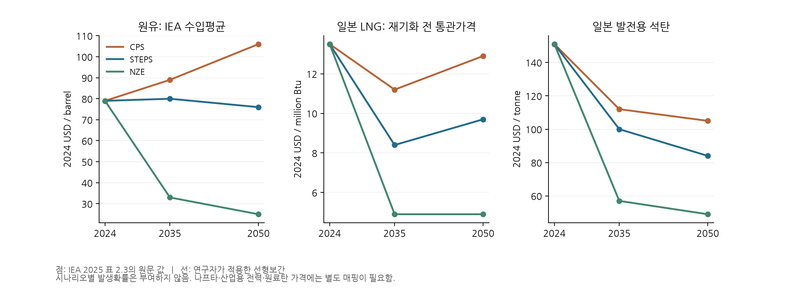
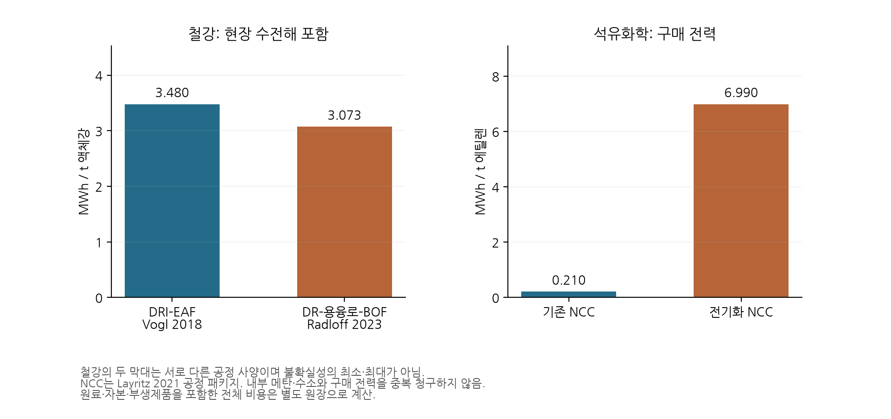
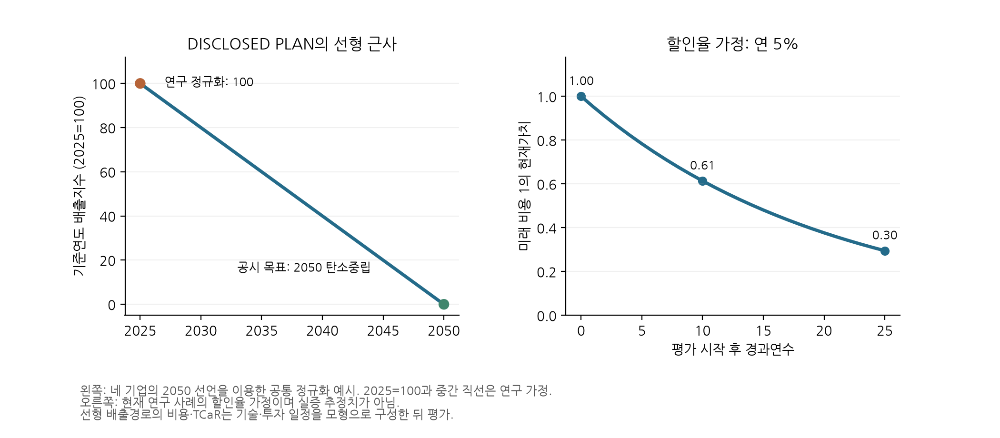

### 3.5 탄소중립 선언 기반의 선형 DISCLOSED PLAN

기업의 탄소중립 선언과 목표연도가 확인되면 이를 선형 배출 기준경로를 구성하는 데 충분한 공시 근거로 인정한다. 상세한 설비·기술 일정이 없다는 이유로 이 비교 기준을 제외하지 않는다. 본 연구는 이 경로를 **선언 기반 선형 DISCLOSED PLAN**으로 부른다. 탄소중립 목표는 기업 공시이며, 그 목표까지의 선형 보간은 연구 가정이다. 선형안과 효율경계의 최종목표·누적배출예산·연간 제약이 다르면 비용 차이에 목표와 감축 시점의 차이도 포함되므로, 이를 기업의 비효율로 묶어 해석하지 않는다.

기준연도 b의 배출량 E_b에서 목표연도 T의 배출량 E_T까지 `E_disc(t) = E_b + (E_T − E_b) × (t − b)/(T − b)`로 연결한다. 탄소중립 목표에는 해당 선언의 순배출 경계에서 E_T=0을 사용한다. 기준연도는 분석 시작연도와 별도로 보존하며, 계산을2027년부터 시작한다고 기존2025년 기준 경로의 감축 시계를 다시 시작하지 않는다. 기준 배출량이 정합화되기 전에는100으로 정규화한 상대 경로를 사용할 수 있다. 실제 비용 계산에는 모형의 물량·배출 범위에 맞는 절대 기준량을 연결한다.

순배출 목표를 직접배출0으로 해석하려면 잔여배출·제거/상쇄 처리에 관한 연구 가정을 별도로 둔다. 회사 전체 선언을 일부 공장에 적용하면 동일 감축률을 적용하는 배분 가정을 기록한다. 중간 목표가 확인되면 단순 선형안을 기본 비교로 유지하면서, 같은 배출 기준으로 환산한 중간 목표를 잇는 구간별 선형안을 추가 비교할 수 있다.

비용·TCaR 좌표는 이 선형 경로를 달성하도록 기술·투자·계약 일정을 모형으로 구성한 뒤 산정한다. 재현 가능한 기본 규칙은 같은 기술 메뉴·생산량·현금회계 아래 선형 연간 경로를 상한으로 두고 중앙가격 비용을 최소화해 일정을 고정한 다음, 다른 후보와 동일한 공동 충격으로 재평가하는 것이다. 이를 **선형 공시경로를 달성하는 모형 기준안**으로 표시한다. 선형 경로 자체와 기업이 실제 발표한 설비투자 계획은 별도 열로 보존한다. 실행 가능한 일정이 없으면 경로는 남기고 어떤 제약 때문에 비용 좌표를 구성하지 못했는지 보고한다.

POSCO·Nippon Steel·LOTTE Chemical·Mitsui Chemicals의2050 탄소중립 목표를 각사 공식 자료에서 확인했다. 현재 정규화 레지스터에는 네 기업의 선언과104개 연간 경로를 등록했다. 기준연도2025=100은 설명용 가정이며 실제 기업의 기준연도별 실적을 대신하지 않는다. [POSCO](https://sustainability.posco.com/S91/S91F10/eng/cmspage.do?mmcd=1750728562003749), [Nippon Steel](https://www.nipponsteel.com/en/carbon-neutral/zerocarbon.html), [LOTTE Chemical](https://www.lottechem.com/en/media/news/545/view.do), [Mitsui Chemicals](https://jp.mitsuichemicals.com/en/sustainability/mci_sustainability/circular_economy/carbon_neutrality/index.htm).

기존6절의 동결 사례는 이 새 선형 비교 규칙을 적용하기 전의 실행이다. 따라서 그 표에서 상세 공시계획 좌표가 없다는 기록과, 선언 기반 선형 경로를 비교 기준으로 허용한다는 현행 방법론을 구분한다. 새 경로 생성 함수는 구현·검사했으며, 비용 기준안 최적화와 독립 MC 재평가 결과는 후속 사례 갱신에 반영한다.

<!-- ASSUMPTION FIGURES -->

### 5.10 핵심 가정값을 읽는 그래프

핵심 가정은 숫자 표와 함께 단위·공정 경계·출처가 표시된 그래프로 제시한다. 가격 시나리오의 차이, 기술이 바꾸는 물량, 할인율과 감축경로의 효과를 먼저 확인하고 분포 결과를 해석한다. 문헌 관측, 시나리오 값, 연구 가정, 추정한 분포 모수를 같은 종류의 관측치로 표시하지 않는다.

**그림 90.** IEA2025 표2.3의 가격 기준값과 연구자의 선형보간. 가격은2024년 실질USD다. 원유는IEA 수입평균, LNG는 일본 통관·재기화 전 가격이며 발열량 기준은 원표에 명시되지 않았다. 석탄은발전용이다. 나프타·공장 전력·원료탄 가격으로 변환할 때 필요한 가격차와 조달계약은 별도 가정이다. 세 경로의 개수는 시나리오 발생확률을 뜻하지 않는다. [IEA 원문](https://iea.blob.core.windows.net/assets/9155992e-962c-45f4-97c1-78fd43a94178/GlobalEnergyandClimateModelDocumentation2025.pdf).

**그림 91.** 문헌 공정 패키지의 구매 전력. 철강은 모두 현장 수전해 전력을 포함하며 두 공정의 스크랩 비율·용융 및 정련 경계가 다르다. 두 값을 하나의 확률분포의 하한과 상한으로 사용하지 않는다. Radloff의 원료·부생제품 일부 대조 차이는 검증 보류로 유지한다. NCC 전력 증가는 내부 메탄의 사용·판매 변화와 함께 평가해야 한다. [Vogl et al.,2018](https://doi.org/10.1016/j.jclepro.2018.08.279), [Radloff et al.,2023](https://doi.org/10.1111/jiec.13387), [Layritz et al.,2021](https://doi.org/10.1016/j.apenergy.2021.117049).

**그림 92.** 왼쪽은2050 탄소중립 선언을 이용해 기준연도2025=100에서 선형으로 연결한 설명용 공시 기준경로다. 중간 직선은 기업의 연도별 실적이나 상세 투자 공시가 아니다. 오른쪽은 현재 연구 가정인 연5% 할인율에서 미래 비용1의 현재가치다. 실제 추정값과 연구자가 선택한 가정을 구별하기 위해 그림 안에도 상태를 표시했다.

가격분포·상관·블록 길이의 영향은5.8–5.9절의 공동 충격 그래프와 함께 읽는다. 후속 그림에는 조달가격 연동률·부생제품 판매비율·기술 성능의 가정이 평균과꼬리에 미치는 영향을 추가한다. 모든 그림의 원자료와 생성 코드는 레지스터·실행 설정과 연결해 유지한다.
