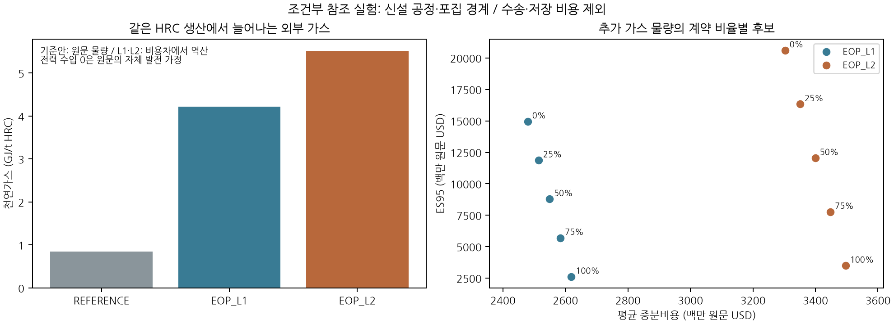
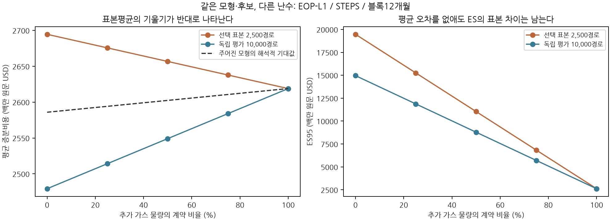

### 6.12 같은 생산물 경계의 철강 포집 참조와 경계 선택의 표본오차

기준 공정과 전환 공정의 경계를 맞추기 위해 IEAGHG 2013/04의 서유럽 신설 제철소 참조를 별도로 구성했다. 연간 4 Mt 열연코일(HRC), 자체 코크스·석회·산소·전력·증기 생산을 포함하는 기준안과 두 후연소 포집안 EOP-L1·L2를 비교한다. 액강까지만 다루는 다른 문헌과 비용을 섞지 않는다. 원문 자체가 전력 수출입 0과 공통 생산·부산물이라는 이상화된 조건을 명시한다. 따라서 이 자료는 한국·일본 기업의 현행 설비를 검증하는 자료가 아니다. 2013년의 비교 가능한 비용항목을 이용한 계산 검증이며, 현재 상용 비용 견적은 별도로 필요하다. [IEAGHG, 2013/04, Volume II Annex I 및 Section D](https://ieaghg.org/publications/2013-04%20Iron%20and%20Steel%20CCS%20Study%20(Techno-Economics%20Integrated%20Steel%20Mill).pdf).

**자료 상태와 비용 범위.** 공식 PDF의 웹 추출 본문에서 75개 수치를 등록했다. 비용합계와 다른 표의 가스비 대조 9건은 표시 정밀도 범위에서 일치하지만, 기준안 가스량의 서술값과 원장값이 다른 1건은 보류했다. 원본 다운로드와 표 이미지 확인이 완료되지 않아 잠정 전사로 표시한다. 기준안 가스량은 원장의 3,398,486 GJ/년을 사용하고, L1·L2의 추가 물량은 원문 총연료비 차이를 9.77 원문 USD/GJ로 나눈 값이다. 이는 직접 관측한 추가 물량과 다르다. 내부 전력·부생가스 거래를 외부 구매나 판매로 이중 계상하지 않았다. 원문 설비비는 2010년 조정값이나 운영가격은 장기 추세 가정이므로 전체 금액을 동일한 USD2010으로 표시하지 않는다. 포집·압축 이후 수송·저장, 예비 가스, 운전자본·금융·세금·종료 현금흐름은 이 참조 계산에 포함하지 않았다.

계산에서는 연구 가정으로 2027–2029년에 신설 투자비를 균등 지급하고 2030–2050년에 정격 생산한다. 원문의 초기 생산 확대 기간을 재현한 것은 아니다. 15번째 운영연도인 2044년에 공통 고로 재라이닝 비용을 지급하며 할인율은 5%다. IEA 2025 유럽 가스 시나리오의 2024년 대비 비율을 원문 가스 단가에 적용하고, World Bank 유럽 가스·철광석을 포함한 동일 월의 공동 충격을 연결했다. 철광석은 고정 구성 원료 묶음의 가격지수 노출로 표현하고 나머지 구매가격·투자비는 고정했다. 원료 등급·운송·조달 차이는 추가로 추정하지 않았다. 원료비는 절대 비용의 위험에 남지만 동일 구매 원장이 두 안에 공통이어서 증분비용에서 상쇄된다.

두 포집 공정에 추가 가스 물량의 고정가격 계약 0·25·50·75·100%를 조합했다. 기존 공통 가스 물량은 두 안 모두 시장가격에 남기고, 계약 단가는 연도별 중심가격에 3%를 더한 확정 일정으로 가정한다. 실제 이용 가능한 상품의 견적이 아니다. 가스 공동 충격이 남는 부분을 제외하면 증분비용의 다른 항목이 결정론적이므로 전량 계약의 TCaR가 0이 되는 것은 이 제한된 모형의 산술적 결과다. 현실의 전환위험이 없어졌다는 증거가 아니다. 비교 제약은 원문 사업장 경계 직접배출의 연간 50% 또는 60% 감소이며, 영구 저장을 포함한 생애주기 감축이나 탄소중립 달성으로 해석하지 않는다.

**그림 13.** 왼쪽의 가스 수요는 기준안 원장값과 전환안 비용차 역산값이다. 오른쪽은 STEPS·12개월 블록·독립 평가 10,000경로의 후보 좌표다. 두 공정은 같은 HRC를 생산하지만 감축 수준이 다르다. 50% 제약에서는 L1·L2를 함께 평가하고 60%에서는 L2만 허용한다. 모든 표시점을 효율점으로 해석하지 않는다. 비용은 백만 원문 USD이며 완전한 CCS 비용을 뜻하지 않는다.

**표본평균을 그대로 선택 축에 사용할 때 생기는 문제.** 2개 블록 길이와 3개 시나리오에서 10개 후보를 선택용 2,500경로와 별도 시드의 평가용 10,000경로로 계산했다. 두 감축 제약을 적용한 12개 조건 모두에서 평균–ES 비지배 후보의 구성이 달라졌다. 네 개 난수 묶음을 시나리오와 제약 사이에 재사용했으므로 12개의 독립 실증시험은 아니다. 추가 계약의 작은 기대 프리미엄보다 긴 가스 경로의 표본평균 오차가 커서, 선택 표본에서는 전량 계약이 평균도 낮추는 것으로 나타났지만 독립 표본에서는 평균을 높이는 것으로 나타났다.

<!-- CAPTURE VALIDATION TABLE -->

이 실험의 물량과 계약은 고정되어 있고 비용이 가격의 선형함수이므로, 명시한 모형의 기대가격으로 기대비용을 정확히 계산할 수 있다. 5.6절의 해석적 기대값을 평균 축에 사용하고 ES는 각 표본에서 계산하면 이번 12개 조건의 비지배 후보 구성은 일치했다. 이는 선택의 평균 축에서 제거할 수 있는 MC 오차를 제거한 결과다. 미래 기대가격을 안다는 뜻도, ES나 모형의 꼬리가 검증됐다는 뜻도 아니다. 위험 감소의 크기와 지불할 가치의 추정에는 두 표본 사이의 차이가 여전히 남는다. 비선형 운영·재무 조건에는 같은 선형 기대값 계산을 자동 적용할 수 없다.

**그림 14.** EOP-L1·STEPS·12개월 블록의 결과. 선은 각 계약 비율에서의 통계량 추이를 보여주며 연속적으로 실행 가능한 기술 frontier의 보간이 아니다. 점선은 주어진 모형의 해석적 기대비용이다. 평균 축을 정확히 계산해도 오른쪽 ES의 표본 차이는 남는다. 따라서 ‘경계점 구성이 같음’과 ‘꼬리 비용이 정밀하게 추정됨’을 별도 검증 항목으로 둔다.

기준안 포함 FIN 비용값 825,000개를 별도 현금식과 대조했고, 전체 두 원장을 차감한 값과 공통 구매를 먼저 상쇄한 증분식도 대조했다. 최대 차이는 각각 2.329×10⁻¹⁰ 백만 원문 USD 이하였다. 이 검사는 계산의 일관성을 확인한다. 잠정 자료의 외부 검증, 기업 매핑, 수송·저장 비용과 계약 위험의 누락을 해소하는 검사는 아니다.
