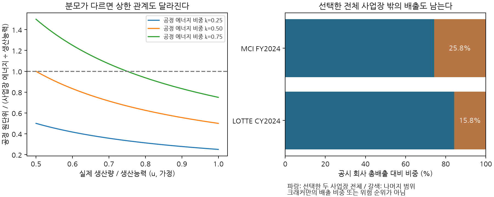

### 5.15 회사 공시에서 공정 후보로 넘어가는 경계

공시 총량은 실제 관측이라는 점에서 중요하지만 특정 설비의 원단위나 감축 가능량과 같지 않다. 회사·사업장·공정의 범위, 기간, 제품, 내부 에너지와 외부 구매를 순서대로 맞춘 뒤 기술 DB를 연결한다. 이번 재검토는 각 회사 보고서의2024년 열을 고정해 아래 원문 총량과35개 관련 수치를 표 이미지와 대조했다. 한국의 달력연도2024와 일본의 회계연도2024는 동일 기간이 아니며, 최신 생산 순위나 국가 간 효율성 비교를 위한 표가 아니다.

| 회사 | 공시 기간 | 원문 총배출 | 원문 단위 | 원문 경계 |
|---|---|---:|---|---|
| POSCO | CY2024 | 71,065,170 | tCO2e | 국내 회사 Scope1+2 |
| Nippon Steel | FY2024 | 79,013 | ktCO2e | 비연결 회사 GHG, 구매 코크스·산소 관련 생산 배출 포함 |
| LOTTE Chemical | CY2024 | 5,902,878 | tCO2e | 모회사 Scope1+2 |
| Mitsui Chemicals | FY2024 | 3,869 | ktCO2e | 모회사 Scope1+2 |

POSCO와 LOTTE의 표시된 Scope1·2를 더하면 공시 총량보다 각각8t 많다. 양쪽 원문은 사업장 단위 절사에 따른 차이를 설명하므로 총량을 합계에 강제로 맞추지 않았다. Mitsui 모회사 표의 두 성분은 원문 정밀도에서 합계와 일치한다. Nippon Steel의 총GHG79,013kt와 표시된 에너지CO2·비에너지CO2·CH4·N2O 네 항목의 합에는22kt 차이가 있다. 네 항목의 표시 정밀도로 설명되는 단순 반올림이라고 단정하지 않고 미조정 차이로 보존한다. 이 차이를 특정 공정의 감축 가능량에 배분하지 않는다. [POSCO, PDF5쪽](https://sustainability.posco.co.kr/assets/file/2024_POSCO_ESG_Factbook.pdf); [Nippon Steel, PDF23쪽·인쇄22쪽](https://www.nipponsteel.com/en/ir/library/pdf/nsc_en_ir_2025_databook_print.pdf); [LOTTE, PDF117쪽](https://www.lottechem.com/pdfRead.do?fileId=FILE_260803112356995); [Mitsui, Part6 PDF2·6쪽](https://jp.mitsuichemicals.com/content/dam/mitsuichemicals/sites/mci/documents/sustainability/report/esg2025web_e_part06.pdf.coredownload.pdf).

**구매 전력 환산의 보류.** POSCO 원표의 전력10,963,428GJ에는 회사의 환산계수가 적용됐다는 각주가 있으나 수치 계수는 명시돼 있지 않다. 종전 참조 DB가 이 값을3.6으로 나누어 산출한0.0869MWh/t 조강은 구매 전력 원단위로의 채택을 철회했다. 보고서의 회계 에너지가 최종 전력량과 같은 정의인지 확인해야 한다. 원문GJ는 그대로 남기고, 미식별 MWh에는0을 넣지 않는다. 전사 천연가스·부생가스·원료탄을 고로 하나의 구매 원장으로 옮기거나, 내부 부생가스와 그 발생 원료의 비용을 함께 더하는 것도 허용하지 않는다. [POSCO, PDF6쪽 각주3](https://sustainability.posco.co.kr/assets/file/2024_POSCO_ESG_Factbook.pdf).

**생산능력은 생산량이 아니다.** 사업장 총에너지E, NCC 생산능력K, 실제 가동률u, 그 사업장 에너지 중 NCC에 귀속되는 비중λ라 하면 NCC 에너지 원단위는 **λE/(uK)**다. E/K가 이 원단위의 상한이 되려면λ≤u가 추가로 필요하다. 예를 들어λ=0.75·u=0.5이면 실제 공정 원단위는E/K의1.5배다. 따라서 여수·대산 전체 사업장 에너지/에틸렌 생산능력 통계를 무조건 NCC 원단위의 상한이라고 해석한 기존 참조 설명을 정정했다. 이는 가동률·배분비중의 조건부 산술이며 그 가정의 확률분포를 추정한 것이 아니다. Mitsui의 사업장 제품 출하량도 여러 제품을 합친 값이므로 에틸렌 생산량 분모로 바꾸지 않는다.

**선형 공시경로와 모형 밖 배출.** 선언만으로 선형 DISCLOSED PLAN을 만드는 규칙은 유지한다. 다만 회사 전체 기준 배출을 E0, 모형이 포괄하는 기준 배출을 Ec, 해당 기술들의 잔여 비율을 r라 하면, 나머지 활동과 배출계수를 고정한 진단 하한은 **(E0−Ec)+rEc**다. 선형 목표가 이 값보다 작아지는 구간에는 범위 밖 감축이나 추가 기술이 필요하다. 목표선을 지우거나 미계산 잔여 부분의 비용을0으로 처리하지 않는다.

LOTTE의 여수 기초·대산 전체 사업장 Scope1+2를 합하면4,972,089t다. 회사 공시 총량과의 차이930,789t, 약15.8%는 두 전체 사업장을 모두0으로 놓아도 남는다. Mitsui의 이치하라·오사카 전체 사업장은2,872kt이고 모회사 나머지는997kt, 약25.8%다. 이 값들은 크래커 단독 배출 비중이 아니다. 오사카 사업장 표와 기존 자산 DB의 크래커 법인·설비 경계도 별도 정합이 필요하다. 두 사업장의 모든 활동을0으로 놓고 나머지 활동·배출계수와 사업장 사이 영향을 고정한 가정이므로 미래 전력 탈탄소까지 반영한 최종 배출 하한은 아니다. [LOTTE, PDF117쪽](https://www.lottechem.com/pdfRead.do?fileId=FILE_260803112356995); [Mitsui, Part6 PDF6–7쪽](https://jp.mitsuichemicals.com/content/dam/mitsuichemicals/sites/mci/documents/sustainability/report/esg2025web_e_part06.pdf.coredownload.pdf).

**그림 1.** 왼쪽의λ와u는 예시 가정이다. 오른쪽은 원문 회사·사업장 총량으로 계산한 경계 비중이며 국가별 전환리스크 순위가 아니다. 대표 크래커의 비용 감소를 회사 전체 탄소중립 달성 비용으로 확장하려면 나머지 배출의 경로와 비용도 함께 구성해야 한다.

