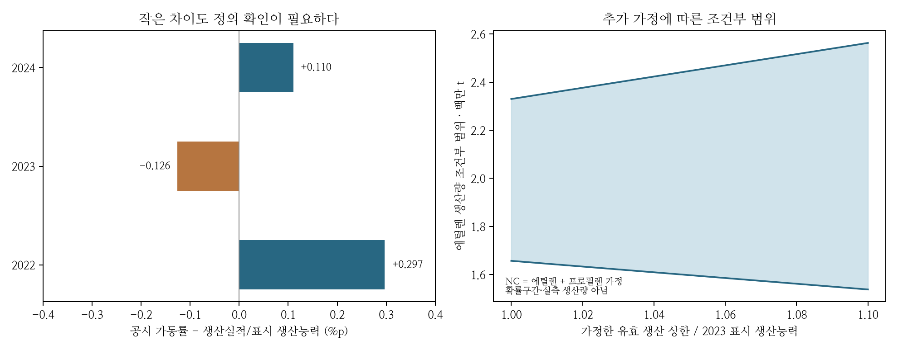

### 5.16 실제 기업의 생산·구매 공시를 공정과 연결하는 조건

한국·일본 사례를 비교하려면 국가별 가격경로에 앞서 기업 자료의 분모를 맞춰야 한다. 같은 ‘생산’ 표에도 철강은 선철·조강·출하제품이, 석유화학은 복수 기초유분·에틸렌·유도품이 섞일 수 있다. 이 차이를 무시하면 국가별 기술 경쟁력처럼 보이는 결과가 실제로는 제품 구성이나 연결 범위의 차이일 수 있다. 이번 대조는 롯데와 일본제철의 생산·구매 표 및 미쓰이의 공급 대응 공시 4건에서 선택한 6쪽에 한정한다. 한국·일본 전체 산업의 대표성이나 네 기업의 완성된 공정 지도를 확보했다는 뜻은 아니다.

롯데케미칼 2024 사업보고서의 기초소재 ‘NC’ 생산능력은 3,521,000t/년, 생산실적은 2,848,129t, 공시 가동률은 81.0%다. 단순히 표시 생산실적을 표시 생산능력으로 나누면 80.890%여서 공시 비율과 같지 않다. 과거 두 해에도 차이가 있어, 표시된 물량 비율로 가동률 정의를 확정하지 않는다. 별도 표의 2023년 에틸렌·프로필렌 생산능력은 각각 2,330,000t/년과 1,191,000t/년이며 합계는 NC 생산능력과 일치한다. 이 일치는 NC가 두 제품의 합이라는 가설과 정합적이지만 정의를 입증하지는 않는다. NC 생산실적을 에틸렌 실적에 그대로 대입하지 않는다. [롯데 사업보고서, PDF34·64쪽](https://www.lottechem.com/pdfRead.do?fileId=FILE_250319162135146&voNm=irdataVo).

불완전한 자료 아래에서도 가정을 분리한 산술 범위는 제시할 수 있다. 총생산 Q가 두 제품 생산량의 합이고, 각 생산량이 가정한 유효 상한 K 이하이면 에틸렌 생산량의 범위는 max(0, Q−K프로필렌) ≤ q에틸렌 ≤ min(Q, K에틸렌)이다. NC가 오직 두 제품의 합이고, 2023 생산능력을 2024에도 유지하며, 그 능력을 유효 상한으로 가정하면 1,657,129–2,330,000t가 된다. 유효 상한을 표시 능력의 1.10배로 완화하면 1,538,029–2,563,000t로 넓어진다. 이는 실제 생산량의 추정구간이나 신뢰구간이 아니다. 공동생산 수율 제약도 아직 부과하지 않은 조건부 범위다. 명목 생산능력은 자동으로 엄격한 물리 상한이 되지 않으므로, 상한 자체의 해석도 따로 검증해야 한다.

**그림 1.** 왼쪽은 롯데 NC 공시 가동률과 표시 물량의 단순 비율 간 차이(%p)다. 작은 차이라도 공시 비율을 임의로 정정하지 않는다. 오른쪽은 NC 구성·능력 유지 가정을 둔 생산량 범위다. 음영 면적에 확률은 부여하지 않았다. 21개 상한 설정은 민감도 격자이며 독립 관측 표본이 아니다.

같은 보고서의 2024년 나프타 가격 675USD/MT에는 ‘국제가격 기준’이라는 주석이 있다. 나프타 구매액 4,786,068백만원은 롯데케미칼과 LC TITAN이 함께 표시된 행이다. 따라서 이 구매액을 국내 모회사 NC 생산실적과 바로 나누거나, 벤치마크 가격으로 나눠 실제 구매량을 복원하지 않는다. 공정 원단위에 곱할 조달가격은 국제 벤치마크에서 환율·운임·품질 차이·계약 시차를 거쳐 같은 기업·기간·원료 기준으로 연결해야 한다. 원료 비용과 연료 비용에 같은 물량을 중복 반영하지 않는 물질수지 검사는 이 연결 뒤에 수행한다. [롯데 사업보고서, PDF32쪽](https://www.lottechem.com/pdfRead.do?fileId=FILE_250319162135146&voNm=irdataVo).

일본제철의 FY2024 결산 자료에는 선철 33.85백만t, 비연결 조강 34.30백만t, 철강제품 출하 31.62백만t가 구분된다. 선철에는 Hokkai Iron & Coke가 포함된다는 주석이 있다. 따라서 앞의 두 물량을 나눈 값을 공정 수율로 채택할 수 없다. 출하량도 같은 기간의 생산량과 자동으로 일치하지 않는다. 철강 참조기술의 액강·열연제품 경계를 기업 설비별 생산 및 구매 철원과 먼저 맞춰야 한다. [일본제철 FY2024 결산, PDF30쪽](https://www.nipponsteel.com/en/ir/library/pdf/20250509_200.pdf).

미쓰이의 2024년 8월 21일 공시는 Osaka Petrochemical Industries 재가동 지연에 대응해 이치하라 물량 이전과 외부 에틸렌 조달을 설명한다. 당시 상반기 실적 영향 약 70억엔은 전망치이며 확정 전환비용이나 톤당 감축비용이 아니다. 10월 재가동 전망과 달리 후속 공시는 실제 9월 30일 재가동을 확인한다. 이 사례는 공급 유연성이 실제 기업의 대응 수단임을 뒷받침하지만, 사건이 기후 전환 때문에 발생했다거나 향후 사고확률을 식별한다는 근거는 아니다. [8월 전망 공시](https://jp.mitsuichemicals.com/content/dam/mitsuichemicals/sites/mci/documents/release/2024/240821e.pdf); [10월 재가동 확인](https://jp.mitsuichemicals.com/content/dam/mitsuichemicals/sites/mci/documents/release/2024/241002_1e.pdf).

이 자료는 효율경계의 선택 집합을 구체화한다. PPA 외에도 생산지 이전, 외부 원료·중간재 조달, 재고 및 공정 운영 유연성을 후보로 둘 수 있다. 다만 각 후보는 같은 최종제품 인도량을 충족해야 하며, 이전·운송·저장·공급 한도와 추가 비용을 포함해야 한다. 기업 연결 원장에서는 내부거래를 상계하고 외부 지출과 물류비를 보존한다. 자체 생산을 줄여 Scope1·2가 감소해도 공급망 배출이 늘었다면 이를 같은 양의 사회적 감축으로 간주하지 않는다. 기업의 비용위험, 투자자의 손실 노출, 정부의 총배출·공급안정성 목적은 이 경계 차이를 명시한 뒤 비교한다.

마지막으로 관측되지 않은 생산량의 범위를 얻었다고 그 안에서 균등분포를 추출할 근거가 생기지는 않는다. 가격충격 ε는 추정한 공동 확률모형에서 생성하고, 생산 구성·유효 능력 같은 미확인 사양 θ는 조건별 결과 또는 별도로 정의한 강건성 문제로 보고한다. 조건별 효율경계는 해당 θ에서 실행 가능한 후보의 비지배 집합이다. 모든 허용 θ에서 실행 가능해야 한다는 강건 제약을 쓰면 후보 집합 자체가 달라진다. 이 둘을 하나의 확정 기업 frontier로 혼합하지 않는 것이 자료 불완전성을 정직하게 비용 꼬리와 연결하는 방법이다.
