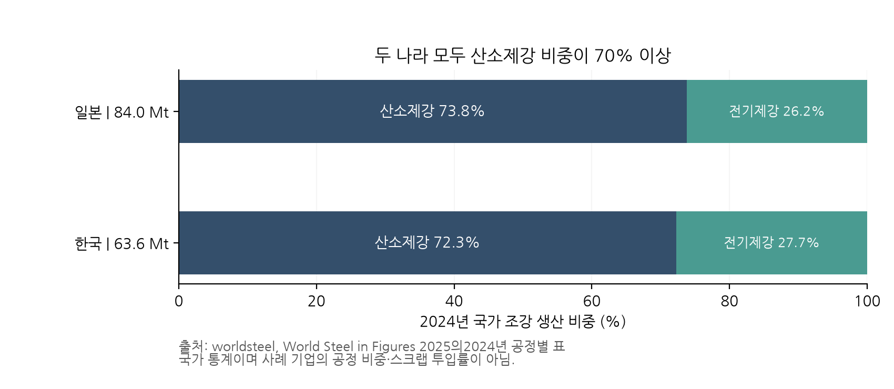
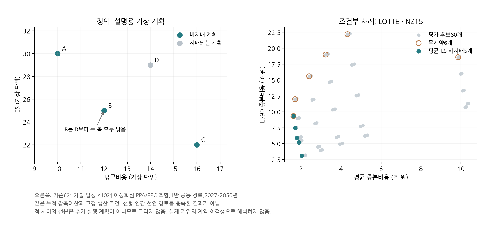

### 2.2 한국·일본의 철강·석유화학을 비교하는 이유

한국과 일본을 함께 보는 이유는 비슷한 산업명이 같은 전환경로를 뜻하는지 검증하기 위해서다. 두 나라는 국제무역과 수입 에너지에 의존하는 산업경제라는 공통점이 있다. IEA의 2025년 양국 투자 검토도 수입 의존, 에너지 안보와 전력 수요 증가를 함께 다룬다. 본 연구가 여기서 도출하는 함의는 원유·가스의 국제가격을 기업 구매가격으로 바로 대입할 수 없다는 것이다. 수입 경계, 운송·재기화, 전력 조달, 계약 연동 및 원화·엔화 환산을 거쳐야 한다. 국가별 가격 차이는 임의의 충격 크기 차이로 대신하지 않는다. [IEA, World Energy Investment 2025: Japan and Korea](https://www.iea.org/reports/world-energy-investment-2025/japan-and-korea).

**철강의 공통 출발점.** World Steel in Figures 2025의 동일한 2024년 공정별 표에서 일본 조강 생산은84.0Mt, 한국은63.6Mt다. 산소제강 비중은 각각73.8%,72.3%, 전기제강은26.2%,27.7%다. 이는 국가 전체 조강의 공정 구성으로, POSCO나 Nippon Steel의 설비 비중이나 전력 원단위가 아니다. 양국 모두 기존 산소제강의 규모가 커서 기존 제철설비의 개조·교체와 전기제강 확대를 함께 검토할 맥락이 있다. 초기 보도자료의 한국63.5Mt와 후속 표의63.6Mt를 섞지 않고, 여기서는 후속2025년 간행물의2024년 표를 고정한다. 2025년 생산의 최신 순위표를 제시하는 목적은 아니다. [worldsteel, 2025, Crude steel production by process 2024](https://worldsteel.org/data/world-steel-in-figures/world-steel-in-figures-2025/).

**그림 1.** 2024년 국가 전체 조강 생산의 공정별 구성. 비중은 원문 표시값이며, 생산량을 기업 사례의 물량으로 배분하거나 전기제강 비중을 스크랩 투입률로 해석하지 않는다.

**한국 철강의 전환 선택.** 산업부가2025년6월 발표한 한국형 수소환원제철 실증사업은2026–2030년 총8,146억원 규모이며, FINEX에 기초한 가루 철광석·수소 활용30만톤급 공정 실증과 기존 전기로의 수소환원철 활용을 포함한다. 이는 실증 지원의 범위이지 상용 설비의 톤당 CAPEX나 성공확률 관측이 아니다. 본 연구에서는 이 맥락 때문에 한국의 분광 기반 경로를 유럽의 펠릿 기반 수소 DRI–EAF 사양과 같은 기술로 합치지 않는다. 원료 형태, 환원·용융 설비, 수소 생산 경계, 전력 수요, 가용연도를 각각 대응해야 한다. [산업부, 2025-06-26](https://www.motir.go.kr/kor/article/ATCL3f49a5a8c/170658/view).

**일본 철강의 전환 선택.** Nippon Steel은 대형 전기로의 고급강 생산, 수소 직접환원, 기존 고로 수소 취입을 병행하는 기술 구성을 제시한다. 고로에서 석탄·코크스가 환원·열 공급 외에도 장입물 지지와 통기 기능을 수행한다는 회사의 공정 설명은 단순한 연료 가격 대체로 기술을 표현하기 어렵게 한다. 이 회사의 기술 전략이 일본 산업 전체를 대표하지는 않지만, 선정 사례에서 왜 기존 고로 개조와 전면 공정 대체를 별도 후보로 두는지 설명한다. 공통 수소가격만 적용하고 두 경로의 원료·전력·잔여 배출을 같게 놓으면 비교의 의미가 사라진다. [Nippon Steel, Carbon Neutral Vision 2050](https://www.nipponsteel.com/en/carbon-neutral/zerocarbon.html).

**한국 석유화학의 전환 선택.** 산업부의2025년12월22일 발표에서는 여수·대산·울산의16개 NCC·PDH 기업이 사업재편안을 제출했고, 업계 자율 설비감축 목표270–370만톤의 이행을 추진한다고 밝혔다. 계획 제출·목표는 실제 감축 완료와 다르며 NCC와 PDH도 다른 공정이다. 이 기록이 본 연구에 주는 함의는 탈탄소 투자가 기존 생산체계를 영구히 유지한 상태에서만 결정되지 않는다는 점이다. LOTTE Chemical의 추정 NCC 사례에서 생산량·폐쇄를 고정한 결과는 공정 전환비용 비교로 읽어야 한다. 산업 재편의 수익성까지 평가하려면 가동률·제품가격·철거·고용·공동설비 비용 및 다른 사업장으로의 생산 이전을 추가해야 한다. [산업부 공식 보도자료, 2025-12-22](https://m.korea.kr/briefing/pressReleaseView.do?newsId=156736207).

**일본 석유화학의 전환 선택.** JPCA는2024년 일본 에틸렌 생산량을4.989Mt로 집계했다. 별도의 나프타 수입 표에서는 같은 해 수입 나프타 물량 중 중동 비중73.6%, 한국 비중12.2%를 제시한다. 이 비중의 분모는 나프타 수입량이며 국내 생산을 포함한 전체 공급량이 아니다. 원료 조달과 국내 생산·판매 환경을 함께 보는 근거로 사용하며, 두 나라의 나프타 비용 충격을 독립으로 놓거나 일본 LNG 지수를 나프타 가격 자체로 취급하는 근거로 쓰지 않는다. [JPCA 생산 통계](https://www.jpca.or.jp/english/06stats/production.htm); [JPCA 나프타 수입 통계](https://www.jpca.or.jp/statistics/annual/nafusa.html).

사례 기업인 Mitsui Chemicals와 Idemitsu는2025년12월 최종 합의에서2027년7월 Idemitsu의 치바 에틸렌 설비를 닫고 Mitsui 설비로 생산을 통합하는 계획을 발표했다. 공동 조달과 에틸렌·프로필렌·C4 등 전체 유분의 공급을 함께 다룬다. 또한2026년1월 Mitsui·Asahi Kasei·Mitsubishi Chemical은 서일본 생산 통합과 바이오에탄올 기반 공정 개발을 포함한 기본 합의를 발표했다. 이들은 각각 공시된 계획이며 실행 완료나 검증된 미래 원단위가 아니다. 이 사례들은 공동 생산·원료 전환·지역 통합도 PPA 외의 전환 선택임을 구체적으로 보여준다. 현재 동결한 MCI 설비 입력이 이 계획들을 반영했다고 주장하지 않는다. [치바 최종 합의, 2025-12-19](https://jp.mitsuichemicals.com/en/release/2025/2025_1219_1/index.htm); [서일본 기본 합의, 2026-01-27](https://jp.mitsuichemicals.com/en/release/2026/2026_0127_2/index.htm).

석유화학에서는 나프타가 원료이고 내부 발생 가스가 열원일 수 있다. 분해로를 전기화해도 원료 탄소와 모든 직접배출이 자동으로 사라지는 것은 아니다. 전기 구매 증가와 남는 부생가스의 사용·판매를 같은 물질수지에서 계산해야 한다. 나프타·에너지·제품가격이 함께 움직이면 비용 위험과 마진 위험도 달라진다. 이는6.8절의 공정 원장과5.7절의 공동 충격 규약을 함께 사용하는 이유다. 제품 수요·매출이 없는 현재 비용 모형으로 산업 전체 수익성이나 구조조정 최적 규모를 계산하지 않는다.

| 국가·산업 맥락 | 후보에 반영할 차이 | 가격·분포 연결 | 현재 사례의 해석 범위 |
|---|---|---|---|
| 한국 철강 | 분광 기반 실증, 기존 자산 교체 시점 | 원료 등급·수소·전력 및 건설비 | 검증된 국내 상용 공정으로 사양을 자동 간주하지 않음 |
| 일본 철강 | 고로 개조·직접환원·고급강 전기로 병행 | 잔존 코크스 노출과 신규 수소·전력 노출 | 회사 전략과 국가 평균을 구별 |
| 한국 석화 | 산단별 사업재편, 생산·자산 변동 | 원료·열·전력과 가동률·제품 마진 | 고정 생산 결과를 구조조정 해법으로 확대하지 않음 |
| 일본 석화 | 공동 조달·생산 통합·원료 다변화 | 수입 나프타·부생품·공동설비 정산 | 예정 통합, 운영 실적, 모형 입력의 판본을 구별 |

네 기업은 무작위 추출된 산업 대표 표본이 아니라 방법론의 작동과 자료 제약을 살피는 목적 표집 사례다. 동일 업종 안의 한국·일본 비교와 동일 국가 안의 철강·석화 비교를 함께 두되, 절대 TCaR 크기의 차이를 국가 효과로 인과 해석하지 않는다. 규모·생산물·자산 나이·자료 품질을 통제하지 않은 차이는 복합적인 사례 차이다. 국가별 제도도 실제 연도·사업장 적용 범위와 순지급 구조를 확인한 뒤 비용에 반영한다.

<!-- FRONTIER EXPLANATION -->

### 4.3.1 왜 이 집합을 frontier라고 부르는가

계산 순서는 기술 DB와 시나리오·공동 충격을 연결하고, 계획별 물량·현금흐름에서 조건부 비용분포를 얻은 뒤, 그 통계량으로 비지배 대안을 고르는 것이다. **효율경계가 확률분포를 만들어 주는 것은 아니다.** MC가 생성하는 것은 명시된 충격 모형 아래의 표본이며, 경계의 모양이 매끄럽거나 그럴듯하다는 사실로 그 모형의 꼬리가 타당하다고 검증할 수 없다. 선택된 계획은 독립 경로에서 다시 평가해야 한다.

효율경계의 경제적 의미는 **같은 생산과 감축 조건을 지키면서 선택한 비용·위험 두 축을 동시에 개선할 수 없는 계획의 집합**이다. 특정 시나리오에서 하나의 계획은 기술·착수 시점·운영·계약을 정하고, 동일한 공동 충격에 노출시켜 하나의 비용분포를 만든다. 그 분포를 평균비용과 TCaR 또는 ES라는 두 좌표로 요약한다. 좌하단이 선호되는 그림에서 다른 계획보다 두 좌표가 모두 나쁘지 않고 하나는 엄격히 좋은 계획이 있으면 해당 점은 지배된다. 그런 점을 제거하고 남는 것이 식(6)의 경계다. 여기서 ‘동시에 개선할 수 없다’는 말에는 한 축을 같게 유지하고 다른 축만 개선하는 경우도 포함한다.

예를 들어 설명용 계획 A=(평균비용10, ES30), B=(12,25), C=(16,22), D=(14,29)를 생각하자. D는 B보다 평균도 ES도 커서 제외된다. A·B·C는 서로 지배하지 않는다. A에서 B로 옮기면 평균비용2를 추가로 부담하고 ES를5 낮춘다. 이 선택을 할지는 위험 선호와 재무 여력에 달려 있다. 높은 위험 감소가 항상 높은 평균비용을 요구한다고 가정하는 것은 아니다. 기술 개선으로 두 축이 함께 낮아질 수도 있고, 모든 후보를 지배하는 계획이 하나뿐이면 경계도 한 점이다.

**그림 2.** 왼쪽은 정의를 설명하는 가상 좌표다. 오른쪽은 기존 LOTTE·NZ15 조건부 실행의60개 평가 후보와 평균–ES90 비지배점5개다.6개 기술 일정에10개 이상화된 PPA/EPC 조합을 평가한 메뉴이며, 빈 원은 무계약6개를 표시한다. 누적 감축예산·같은 생산·같은 가격경로 아래의 비교다. 이 그림은 선형 연간 DISCLOSED PLAN 충족 결과나 실제 이용 가능한 계약의 최적성 검증이 아니다. 점 사이를 이어 새로운 실행 가능 계획을 만들지 않는다.

**Markowitz에서 차용한 것.** 기대 성과와 위험을 함께 보며 열등한 선택을 제외한다는 논리를 차용한다. 수익 대신 증분비용을 최소화하고, 위험 축에는 분산 대신 TCaR 또는 ES를 명시적으로 선택한다. 금융자산의 비중을 조절하는 대신 이산적인 공정·설비·투자 일정을 비교하므로 정규분포, 연속 분할, 매끄러운 볼록 경계 또는 분산투자의 이득이 그대로 따라오지 않는다. 경계 위의 어느 점이 기업에 최선인지 결정하는 선호·제약도 별도로 필요하다. [Markowitz, 1952](https://doi.org/10.1111/j.1540-6261.1952.tb01525.x).

**수학적으로 필요한 조건.** 비어 있지 않은 유한 후보 집합에서 두 좌표가 유한하면 비지배점이 적어도 하나 존재한다. 평균비용을 최소화하고 동률에서 위험을 최소화한 점을 고르면 된다. 이를 지배하는 점이 있다면 앞선 최소화 결과와 모순된다. 그러나 전체 실행 가능 집합이 무한할 때의 해 존재는 별도의 닫힘·유계성·연속성 등 조건을 검토해야 한다. 본 연구의 유한 집합 결과로 그 존재나 전체 탐색을 증명하지 않는다.

같은 유한 집합에서 위험 상한 ε 아래 평균비용을 최소화하고 평균 동률에서는 위험을 최소화하면 비지배 해를 얻는다. 각 비지배점의 위험값을 ε로 사용하면 그 좌표를 복구할 수 있다는 것이 ε-제약 접근의 근거다. 단순 가중합은 비볼록한 이산 집합의 일부 비지배점을 놓칠 수 있다. 현재 E2는 중앙가격 비용과 위험 대리값 등으로 후보를 만들고 E5에서 공동 MC 비용분포를 재평가한다. 따라서 E2의 ε 격자를 돌렸다는 사실은 실제 평균–TCaR 또는 평균–ES 경계 전체를 찾았다는 증거가 아니다. [Mavrotas, GAMS 다목적 최적화 기술보고서](https://www.gams.com/modlib/adddocs/epscm.pdf).

**이 논문에서 주장하는 경계의 수준.** 전체 실행 가능 집합 X의 이론적 경계, 생성한 후보 A의 분포 모형상 경계, N개 MC 표본으로 추정한 A의 경계는 다르다. 현재 표와 그림은 세 번째에 해당하므로 **시나리오·공정 가정에 조건부인, 평가 후보의 추정 효율경계**라고 부른다. 후보를 추가하면 기존 경계점이 지배될 수 있고, 표본을 바꾸면 가까운 점의 순서가 바뀔 수 있다. 동일 분포·동일 후보평가 값에서 선택 집합이 확장되면 이전 선택을 계속 사용할 수 있으므로 가능한 최선의 선택이 나빠지지는 않지만, 이는 모든 기존 경계점이 살아남는다는 뜻이 아니다. 독립 MC 평가와 후보 확장 검사는 각각 표본오차와 탐색 누락의 일부를 점검한다. 둘 중 하나로 전체 오차를 대체하지 않는다.

**TCaR 경계의 해석.** 평균–TCaR 경계는 평균비용과 중앙값 위의 분위수 간격이라는 두 통계량에 관한 경계다.4.2절처럼 TCaR가 손실에 단조적이지 않으므로, 이 좌표의 비지배성을 모든 상태에서 더 좋은 경제적 선택과 동일시하지 않는다. 현재 도구는 표본의 모든 경로에서 비용이 더 높은 후보를 별도 표시하고 의사결정 선택에서 제외한다. 그 표본 검사는 미래 전체 상태의 지배성 증명이 아니다. 평균–ES 경계와 원래 비용 분위수를 함께 제시해 위험 간격 감소와 꼬리 비용 수준 감소를 구별한다.

**감축비용 곡선 및 PPA 비교와의 차이.** 통상적인 한계감축비용 도표는 기술별 단위 감축비용과 감축량을 설명한다. 본 연구의 축은 일정 전체의 할인 증분비용과 조건부 비용분포의 위험이다. 공동 원료·에너지 가격, 기술 간 양립성, 건설기간, 감축 마감 때문에 개별 기술의 단위비용 순서를 그대로 기업의 최적 일정으로 사용할 수 없다. PPA는 이 일정에 더할 수 있는 계약 후보 중 하나다. 기술·운영·계약의 선택 범위를 밝히지 않은 채 특정 PPA 비율을 경계의 정의로 삼지 않는다.

기업·투자자·정부의 경계도 동일하지 않다. 기업 비용의 꼬리를 다른 계약 당사자나 정부에 이전해 기업 좌표가 개선될 수 있다. 투자자는 배당·채무·회수 구조로 손실을 다시 계산해야 하고 정부는 재정 지급과 실제 자원비용을 별도 평가해야 한다. 따라서 본문 경계는 기업의 사적 전환비용 경계이며 사회후생 경계로 이름을 바꾸지 않는다. 선형 DISCLOSED PLAN과의 거리 역시 같은 생산·배출·회계 제약에서 비용 좌표가 만들어진 경우에만4.4절의 개선 여지로 해석한다.

<!-- CONTEXT REFERENCES -->

24. World Steel Association. (2025). World Steel in Figures 2025. 표: Crude steel production by process 2024. [공식 통계](https://worldsteel.org/data/world-steel-in-figures/world-steel-in-figures-2025/).
25. IEA. (2025). World Energy Investment 2025: Japan and Korea. [공식 분석](https://www.iea.org/reports/world-energy-investment-2025/japan-and-korea).
26. 산업통상자원부. (2025-06-26). 한국형 수소환원제철 실증기술개발사업 예비타당성 조사 통과. [공식 발표](https://www.motir.go.kr/kor/article/ATCL3f49a5a8c/170658/view).
27. 산업통상부. (2025-12-22). 3개 산단,16개 기업 모두 사업재편안 제출, 구조개편 첫 단추 성공적으로 끼웠다. [공식 발표](https://m.korea.kr/briefing/pressReleaseView.do?newsId=156736207).
28. Japan Petrochemical Industry Association. Production for Major Petrochemicals; 석유화학용 원료 나프타(일본어 통계의 번역 제목). 2024년 관측 열. [생산](https://www.jpca.or.jp/english/06stats/production.htm); [나프타 수입](https://www.jpca.or.jp/statistics/annual/nafusa.html).
29. Nippon Steel. Carbon Neutral Vision 2050. [공식 전략 페이지](https://www.nipponsteel.com/en/carbon-neutral/zerocarbon.html). 조회2026-09-08, 기업 자체 기술전략 설명.
30. Idemitsu Kosan and Mitsui Chemicals. (2025-12-19). Idemitsu Kosan and Mitsui Chemicals Reach Final Agreement on Consolidating Chiba Ethylene Complexes to Optimize Production. [공식 발표](https://jp.mitsuichemicals.com/en/release/2025/2025_1219_1/index.htm).
31. Asahi Kasei, Mitsui Chemicals and Mitsubishi Chemical. (2026-01-27). Asahi Kasei, Mitsui Chemicals, and Mitsubishi Chemical enter basic agreement to promote decarbonization of ethylene production in western Japan. [공식 발표](https://jp.mitsuichemicals.com/en/release/2026/2026_0127_2/index.htm).
