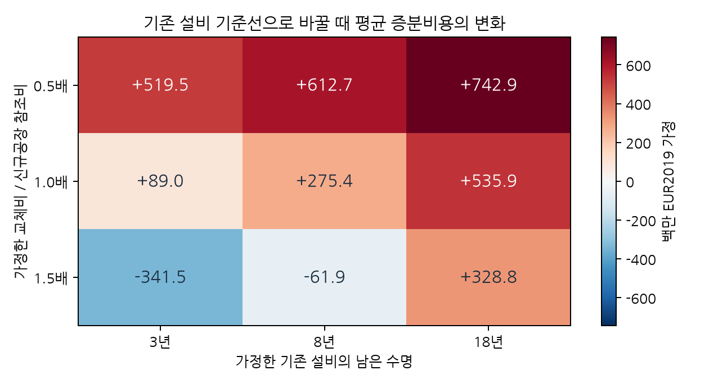

### 6.14 기존 설비 유지와 신규 전환: 매몰 투자와 미래 교체의 구분

6.13절의 두 신규공장 비교를 기존 기업의 전환비용으로 해석하려면 별도의 기준선이 필요하다. 평가 시작 전에 지출한 자본은 다시 현금지출로 청구하지 않되, 앞으로 발생할 재투자·유지비와 폐쇄·처분 현금은 남겨야 한다. 장부상 손상 또는 잔존 장부액은 실제 처분 수입이나 기회비용과 같지 않다. 현금효과가 있는 세금·금융 항목을 다루려면 해당 원장을 별도로 연결해야 한다.

이를 확인하기 위해 기존 자본 원장을 문헌 NCC 참조와 연결했다. 기존 설비가 2027년부터 같은 연간 에틸렌 물량을 생산한다고 가정한다. 유지안은 기존 공정으로 계속 생산하고, 전환안은 2027–2029년 전기화 설비를 건설하는 동안 기존 공정으로 공급한 뒤 2030년에 전환한다. 따라서 건설기간의 생산·운영비도 두 안에 공통으로 존재한다. 원문은 기존 설비의 운영 사양과 교체비를 관측한 자료가 아니므로, 기존 설비의 사양·유지비에는 재래식 신규공장 참조값을 대용했다. 교체비는 같은 신규설비 비용의 0.5·1·1.5배, 남은 수명은 3·8·18년이라는 별도 가정으로 뒀다.

교체비 배율은 미래 자본 지출만 바꾸며 유지비 대용치는 고정한다. 기존 플랜트와 보일러의 교체 주기는 각각 30·25년으로 가정하고, 남은 수명이 끝나는 해에 교체비를 지출한다. 전환이 시작되는 해와 교체 시점이 같으면 해당 기존 설비의 교체를 피하며, 전환 이전에 이미 도래한 교체는 지출로 남긴다. 이는 교체 중 생산중단이 없다는 단순화다. 실제 정비·대체 조달을 검증한 일정은 아니다. 폐쇄 지출·처분 수입·말기 잔존가치는 이번 실행에서 명시적으로 0을 가정했다. 원문 비현금 장부값을 확보하지 못했으므로 교체비 기준 직선 잔존액은 설명용 대용치로만 별도 기록하고 현금비용에 더하지 않았다.

| 기존 설비의 남은 수명 가정 | 평균 증분비용 | ES95 | TCaR95 | 신규공장 비교 대비 평균 차이 |
|---|---:|---:|---:|---:|
<!-- INCUMBENT TABLE -->

단위: 백만 EUR2019 가정. 표는 교체비 배율1, STEPS 가격비율과 동일 5,000개 공동 가격경로를 사용한 조건부 결과다. 서로 다른 수명은 기술 선택 후보가 아니라 비교 기준선의 사양 차이다.

교체비 배율과 수명을 조합한 9개 조건에서는 신규공장 비교 대비 평균 차이의 부호도 달랐다. 가까운 시점의 비싼 교체를 피할 수 있으면 전환의 경제적 부담이 낮아질 수 있고, 기존 설비를 오래 유지할 수 있으면 당장 새로 투자하는 전환안의 상대 비용이 커질 수 있다. 모든 조건이 같은 확률로 일어난다는 해석이나 특정 기업에 대한 방향 예측은 하지 않는다.

**그림 1.** 숫자는 기존 설비 유지 기준으로 바꿀 때 신규공장 비교 대비 평균 증분비용의 변화다. 각 칸은 대안적 기준선 가정이며 확률이나 기술의 선택 비율이 아니다. 같은 가격 표본을 공유한다.

동일 운영·가격 사양에서 이 차이는 확정 자본비 이동이므로 TCaR가 사실상 같아도 평균과 ES 수준은 달라진다. 기준선의 초기 신규투자를 제거하고 미래 교체 현금을 반영한 차이가 각 가격경로에서 그대로 나타나는지 독립 수식으로 대조했다. 9개 조건·한 공동 난수 묶음에서 두 기술안의 FIN 비용값 90,000개와 연간 원장 432행을 생성·검사했다. 별도 수식 대조는 비용값에 적용했으며 432행 전체를 기업 원문과 대조한 것은 아니다. 관련 검사 19개 중 13개는 이번 기존 설비 연결의 검증이다.

이 결과는 기존 자산 상태를 정의하지 않은 비용–위험 경계가 기업 의사결정을 설명하기 어렵다는 점을 구체화한다. 기존 유지안이 실제 배출 제약을 만족하는지, 전환 이후 남은 배출을 어떻게 감축할지는 별도 조건이다. 감축 제약을 충족하지 못하는 유지안도 증분비용을 정의하는 회계 기준선으로는 쓸 수 있지만, 같은 제약을 만족하는 최적화 후보라고 표시해서는 안 된다. 이번 실행은 기업별 수명·기존 기술·감축 가능성을 검증한 frontier나 개조 견적이 아니며 탄소·노무·운전자본·금융·기타 공동생산품의 누락도 계속 남는다.
