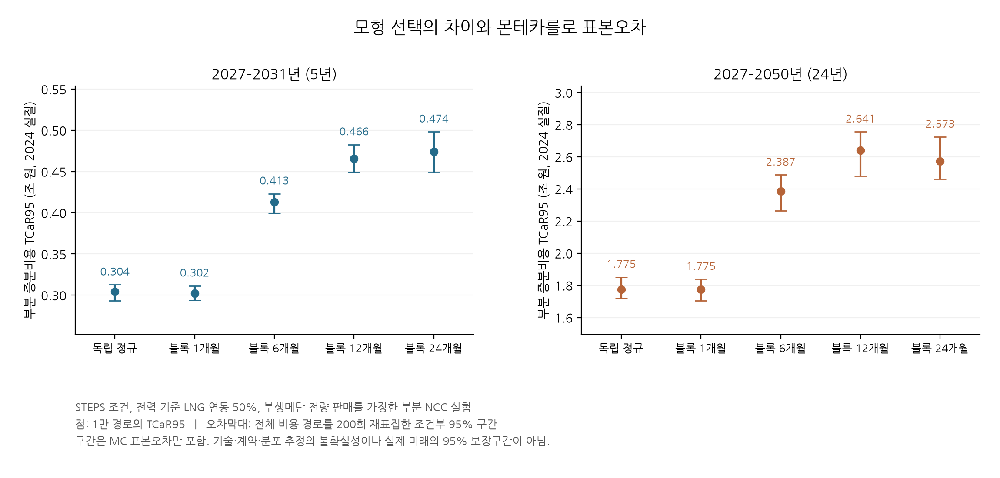
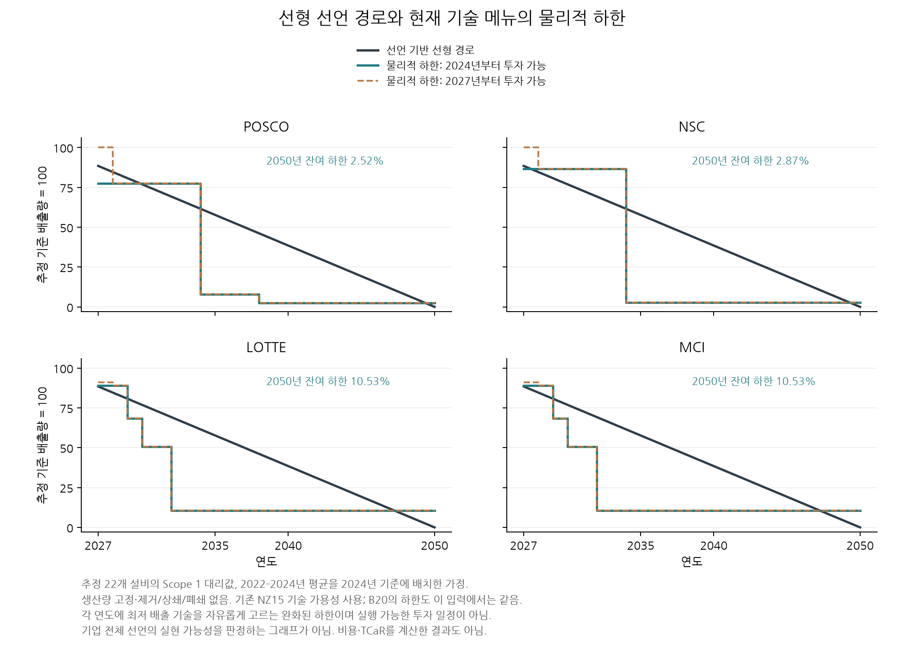

### 5.11 공통 벤치마크를 실제 구매·판매 원장에 연결하는 규칙

충격을 넣을 대상은 가격표의 모든 셀이 아니라 경제적으로 구별되는 위험요인이다. 나프타와 원유, 기업 전력요금과 LNG, 메탄 판매 넷백과 LNG를 각각 독립적으로 흔들면 공통 시장요인의 영향을 잃을 수 있다. 반대로 벤치마크만 공유하고 기업별 가격차·수량·신용 위험을 모두 0으로 놓으면 위험을 과소평가할 수 있다. 본 절은 이 두 문제를 분리하는 연결 규칙과, 실제로 계산한 제한된 NCC 참조 사례를 제시한다.

IEA GEC 2025의 CPS·STEPS·NZE 원유 및 일본 LNG 중심 가격을 원표에서 전사하고 노드 사이를 선형 보간했다. 원유는 수입 평균 USD2024/bbl, 일본 LNG는 USD2024/MMBtu이며 이번 추출에서 발열량 기준은 미지정이다. 원문 2024년 값으로 각 연도의 가격을 나눈 비율을 R_o,t와 R_g,t라 한다. 이 비율을 기업 조달가격에 적용하는 것은 별도 가정이다. 원표의 탄소가격을 해당 기업의 산업 탄소지출로 자동 이전하지 않는다. [IEA GEC 2025 모형 문서, 표 2.3–2.4](https://iea.blob.core.windows.net/assets/9155992e-962c-45f4-97c1-78fd43a94178/GlobalEnergyandClimateModelDocumentation2025.pdf).

연간 공동 가격 배율 M_o,t와 M_g,t는 5.8절의 월별 경로에서 산술 평균으로 만든다. 전력 기준가격 p_e, 나프타 기준가격 p_n, 메탄 기준 넷백 p_m, 전력의 기준 연도 LNG 연동 비중 β를 두면 다음 연결을 사용한다. 가격 기준연도는 모두 2024년이며, 아래 식에서 전력은 EUR/MWh, 나프타·메탄은 각각 EUR/t이다.

`P_e,t = p_e × [(1−β) + β R_g,t M_g,t]`

`P_n,t = p_n × R_o,t M_o,t`, `P_m,t = p_m × R_g,t M_g,t`

이는 전력요금의 고정 성분과 LNG 연동 성분을 구분한 예시이며 실제 PPA 계약이 아니다. 중심 가격에서 연동 성분이 차지하는 비중은 β R_g,t / [(1−β)+β R_g,t]이므로 시간이 지나도 그 비중이 β라고 놓으면 기준가격의 고정 성분까지 잘못 변한다. 같은 LNG 배율을 사용해도 중심 가격·연동 비중·거래 단위를 함께 보존해야 한다. 나프타에는 Brent 충격을 IEA 수입 평균 원유에 적용하는 가격 차이 가정도 존재한다.

매년 생산량 Q가 일정하고 남는 메탄 판매 비율이 f라면, 전기화의 에너지·판매 부분 증분비용은 다음과 같다. d_t는 시작 연도로 할인하는 계수, F는 KRW2024/EUR2024 고정 환산 가정이며 10⁹로 나누어 십억 KRW2024로 보고한다.

`ΔC = (F Q / 10⁹) × Σ_t d_t [6.78 P_e,t − 0.488 f P_m,t]`

원료 나프타는 공정 전후 모두 3.58t/t 에틸렌이므로 두 총 부분 비용에 포함한 뒤 동일 경로의 차액에서 상쇄된다. 이 상쇄는 나프타 위험을 무시한 결과가 아니라, 고정한 생산량·원단위·계약 아래의 항등식이다. 수율·원료 구성·계약·재고·생산량이 바뀌면 원유와 나프타 위험이 증분 비용에 다시 남는다. 현재 사례에는 제품가격과 매출을 넣지 않았으므로 나프타 위험이 기업 마진에서도 없어진다고 해석하지 않는다.

이 식을 전개하면 확정 부분에 `[6.78 p_e β − 0.488 f p_m] × R_g,t M_g,t`를 더한 형태다. 따라서 현재 부분 증분비용은 공동 가격 경로를 사용하더라도 구조적으로 **LNG 한 요인의 가중합**으로 축약된다. 전력 연동이 0이고 판매가 가능하면 낮은 가스가격이 판매 크레딧을 줄여 비용을 높이고, 연동이 충분히 크면 높은 가스가격이 전력비를 더 크게 높인다. p_e=100, p_m=500, f=1에서 β≈0.359882이면 이 한 요인까지 정확히 상쇄된다. 실제 기업의 무위험 계약을 발견한 것이 아니라 가격 차이·수량·신용·환율 잔차를 제외한 모형의 항등식이다. 실제 대응안의 우수성을 평가하는 메뉴에서는 이 검증용 점을 제외했다.

모형은 가격경로의 시나리오, 연도, 경로 식별자, 통화·기준연도, 물량 단위 및 거래 경계를 검사한다. 동일한 경로 식별자를 가진 기준·전환 비용만 차감하며 원료 비용이 중심 원장에 이미 포함돼 있으면 충격에 따른 차액만 추가한다. 중심가격을 바꿨을 때 내장 원료비가 과거 중심가격에 머무는 경우에는 공정 원장을 다시 만들도록 요구한다. 음수 메탄 넷백은 양의 가격을 전제한 비율 함수에 억지로 넣지 않고 명시적인 가격수준 연결로 처리한다.

### 5.12 PPA 외 대응과 위험 부담의 구분

학술적으로 헤징의 가치는 비용분산 자체를 줄이는 데만 있지 않다. Froot, Scharfstein and Stein은 외부조달이 내부자금보다 비쌀 때 헤징이 투자기회에 필요한 자금을 보존할 수 있다는 근거를 제시한다. Pindyck의 비가역적 투자 연구는 정보를 기다리거나 투자를 연기할 선택의 가치를 설명한다. 본 연구에서 이 논거를 적용하려면 투자 시점별 자금과 감축 마감·누적 배출·지연 비용을 함께 계산해야 한다. 현재 TCaR만으로 이 투자·금융 가치를 모두 측정한 것은 아니다. [Froot et al., NBER 작업논문 및 출판 정보](https://www.nber.org/papers/w4084); [Pindyck, 1991, 도입부](https://www.mit.edu/~rpindyck/Papers/IrreverUncertInvestmentJEL1991.pdf).

전환위험 대응은 물리적 노출 감소, 관측 정보에 따른 운영·투자 조정, 계약을 통한 지급액 이전, 손실 흡수 능력, 정보·제도 개선으로 구별한다. 효율 개선과 원료 대체는 가격에 곱하는 물량을 바꾸고, 저장·가동 조절·단계 투자는 시점별 결정 규칙을 바꾸며, PPA와 장기 원료·제품 계약은 지급함수를 바꾼다. 계약을 체결했다는 이유로 시장가격 충격 자체의 표준편차를 임의로 줄이지 않는다. 정보가 늘어나면 새 위험을 발견해 추정 꼬리가 커질 수도 있다.

운영 유연성은 당시까지 관측 가능한 정보로 행사하는 정책이어야 한다. 경로의 미래 전체를 보고 매번 유리한 기술을 고르는 완전예견 해는 실행 가능한 투자전략의 비용으로 보고하지 않는다. 대안 비교는 같은 생산·감축 제약과 공동 충격을 유지하고, 신규 자본비·거래비·저장 한도·계약 물량·신용 위험을 포함해야 한다. 기존 선택을 그대로 포함하는 확대 가능집합에서 최적 목적값이 나빠지지 않는다는 집합 포함 논리와, 제한된 후보 탐색이 실제로 더 좋은 점을 찾는지는 다른 주장이다.

기업에는 증분 비용과 투자 시점별 자금 부족, 투자자에게는 지분·부채의 지급순위·만기·채무불이행·회수 구조를 반영한 손실, 정부에는 추가 감축과 실물 자원비용·재정 지급액 및 재정 꼬리가 각각 필요하다. 기업의 TCaR 감소를 투자자의 손실 감소나 사회후생 증가로 동일시하지 않는다. 계약·보조금의 양측 지급액은 같은 경로·통화·연도에서 별도 원장으로 추적하며, 기업 비용과 그 기업 소유자의 손실을 사회적 비용으로 중복 합산하지 않는다. 본 논문에서 투자자 자산가치 및 정부 후생 모형의 완성된 실증 결과를 제시하는 것은 아니다.

<!-- JOINT CASES -->

### 6.9 시나리오·공동 충격을 적용한 장기 NCC 참조 실험

5.11절의 부분 원장을 실제 현금흐름 엔진과 독립 수식으로 계산했다. 전력·나프타·메탄 기준가격은 각각 100EUR2024/MWh, 600EUR2024/t, 500EUR2024/t이며 모두 예시 조달 가정이다. 에틸렌 생산량은 매년 100만t, 메탄 전량 판매, 고정 환산율 1,500KRW2024/EUR2024, 실질 할인율 5%를 사용했다. CAPEX·탄소·기타 OPEX·제품 매출·생산 조정은 제외했다. 기존 6.1–6.8절의 기업 시나리오 NZ15·B20과 새 IEA 시나리오는 이름만 바꾼 동일 자료가 아니다.

3개 IEA 시나리오, 5개 가격생성법, 2027년부터 5·10·24년의 지평, 3개 난수 시드, 1천·1만·5만 경로와 전력 연동 비중 0·0.5·1을 평가했다. 같은 시드에서 작은 표본은 큰 표본의 앞부분이므로 이 표본크기들을 독립 반복으로 세지 않는다. 아래 표는 STEPS·연동 비중 0.5·2027–2050·선택용 시드 20260908의 1만 경로 결과다. 단위는 2024년 실질 조원이다. 구간은 전체 비용 경로를 200회 재표집한 조건부 MC 백분위 구간이며 미래 가격 예측구간이 아니다.

<!-- TAIL TABLE -->

서로 다른 블록 길이는 가격모형의 민감도이며 각각의 발생확률을 뜻하지 않는다. 12개월 블록의 TCaR95가 24개월보다 큰 단일 표본의 순서는 표본오차 구간이 겹친다는 사실과 함께 읽어야 한다. 두 방식 중 현실에 더 타당한 모형을 이 비교로 선택하지 않는다. 조건부 구간에는 역사자료·모수·기술·조달·미관측 위기의 불확실성이 포함되지 않으며, 두꺼운 꼬리에서 명목 포함률이 자동 보장되지도 않는다.

**그림 1.** 시나리오·공정 및 조달 가정을 고정한 장기 NCC 부분 비용의 조건부 검증. 같은 기대가격에서도 분포 생성법에 따라 꼬리가 다르며 경로 수 증가는 모형 선택 문제까지 해결하지 않는다. 5년과 24년의 NPV는 포함 현금흐름 수가 다르므로 연간 위험처럼 직접 비교하지 않는다.

정확한 적률 계산은 가능한 역사적 블록 시작점에서 지수변환의 1·2차 적률을 유한합으로 계산한다. 독립 블록 사이에서는 적률을 곱하고, 같은 블록 안의 월 공분산을 유지한다. 월별 비용 가중치 w에 대해 분산은 w′Cov(M)w이다. 작은 표본에서 모든 블록 조합을 열거한 값과 일치했고, 24년·5모형·각 5만 경로의 총 25만 FIN 비용 경로를 독립 수식과 대조한 최대 차이는 1.46×10⁻¹¹ 십억원이었다. 이는 계산의 내부 검증이며 현실의 장기 분포 검증과 다르다.

선택 검사는 (1−λ)평균비용+λES95를 최소화하는 연동 비중을 선택 표본에서 고정한 뒤 별도 두 시드 각 5만 경로에서 평가했다. λ=0·0.25·0.5·1은 추정하지 않은 선호 가정이다. 선택용 1천 경로에서는 360개 비교 중 12개가 평가 표본의 최선 메뉴와 달랐고, 1만 경로에서는 이 실험의 360개가 일치했다. 1천 경로에서 최대 평가 목적값 차이는 0.4814조원이었다. 이 차이는 독립 평가 표본의 최선 메뉴 대비이며 모집단 최적성 격차의 확정값이 아니다. 이 결과를 보편적인 기술 선택 안정성으로 해석하지 않는다.

한편 기존 45개 기술 일정의 무계약 평가를 별도 실행한 225개 통계는 과거 450개 후보의 공통 부분집합과 같았다. 기존 8개 기업–시나리오 조합의 평균비용 최소는 모두 무계약이었다. ES에서 보이는 PPA의 효과는 확정 물량과 연도별 중심가격 계약이라는 이상화된 조건에 의존한다. 따라서 PPA를 본 연구의 정답으로 전제하지 않는다. 새 공동 가격을 적용한 이 절의 연동 비중 실험과 기존 PPA/EPC 기업 후보 결과를 합쳐 하나의 실증 frontier로 표시하지 않는다.

### 6.10 선형 DISCLOSED PLAN과 현재 기술 메뉴의 물리적 하한

기업의 탄소중립 선언만으로 선형 경로를 허용하는 규칙을 유지한다. 다만 비용 좌표를 만들기 전에, 이 경로를 현재 모형의 기술·생산 조건이 충족할 수 있는지 진단한다. 설비 f의 고정 생산량을 Q_f라 하고, 연도 t까지 가용성과 건설기간을 만족하는 호환 기술의 최소 직접배출계수를 e_min,f,t라 하면 낙관적 하한은 `L_t = Σ_f Q_f e_min,f,t`이다. 기존 기술도 최소값 비교에 포함한다.

이 하한은 설비가 매년 가장 낮은 계수의 기술을 다시 고를 수 있도록 투자·전환 제약을 완화한 값이다. 따라서 같은 물량·기술 범위의 실행 가능한 일정은 이 값보다 낮은 배출량을 가질 수 없다. L_t가 선형 목표를 초과하면 현재 범위의 충족은 불가능하지만, 하한이 목표보다 낮다는 사실만으로 실행 가능한 일정이 증명되지는 않는다.

현재 22개 추정 설비의 2022–2024년 평균 생산량·직접배출량을 2024년 대리 기준에 배치했다. 실제 보고된 2024년 값이나 기업 전체 선언의 검증된 범위가 아니다. 기존 NZ15·B20, 최초 투자연도 2024·2027, 4기업의 16사례를 진단했다. 생산 축소·폐쇄·제거·상쇄는 제외했다. 아래 표는 현재 입력에서 두 기존 시나리오가 동일한 하한을 갖는 경우다.

<!-- DISCLOSED TABLE -->

**그림 1.** 허용한 선형 선언 경로와 현재 고정생산·추정 설비의 낙관적 기술 하한. 모든 16개 조건에서 초과분이 있어 실행되지 않는 경로에 비용·TCaR를 부여하지 않았다. 실제 기업 선언이 불가능하다는 판단이 아니며, 빠진 기술·생산 변경·잔여 감축과 공시 범위를 보완할 위치를 보여준다.

초기 건설기간의 지연과 2050년 잔여 배출을 무료 감축이나 임의의 확정 제거가격으로 메우지 않는다. 출처가 있는 제거·잔여 감축, 생산 및 자산 변경을 추가하면 가능집합 자체가 달라지므로 비용과 배출 제약을 함께 재평가해야 한다. PPA 같은 가격 계약만으로 빠진 물리적 감축 경로가 만들어지지는 않는다. 이 진단은 선형 비교경로의 자격을 취소하는 것이 아니라 비용 좌표를 산출할 때 필요한 추가 조건을 명시하는 절차다.

<!-- JOINT WORKBOOK -->

### 7.4 새 공동 가격 모듈의 Excel 입력–실행–결과 연결

7개 시트의 별도 공동 가격 통제 파일은 15개 입력을 받아 5.11절의 NCC 부분 원장을 실제 FIN에 전달한다. `Control`에는 시나리오·충격 생성법·기간·생산량·가격·연동 및 판매 비중·환산·할인·α·경로 수·시드를 두었다. `Scenario source`의 81개 시나리오·연간 행과 `Technology DB`의 4개 물량은 출처를 보존한다. `Annual cost`는 중심 가격·물량·구매비·판매 크레딧·할인을 연결한다.

`NCC reference`는 추가 출판본39개 수치 행과 보충자료 부산물7종을 보존하고,5개 단위 변환을 수식으로 계산한다. 원문 위치·단위·가격 근거와 채택 보류를 함께 표시한다. 이 시트의 수치는 현재 Layritz 부분 원장의 MC 입력으로 자동 적용되지 않는다. 원문 수치가 바뀐 파일의 재실행은 출처 검토 전까지 거부한다. 따라서 DB에 값을 추가한 것과 비용 모형에 채택한 것을 구별할 수 있다.

`Cost paths`의 기준·전환 비용은 동일한 1만 경로에서 계산하고, 증분 비용은 두 비용의 차이로 재계산한다. `MC summary`는 경로 데이터에서 평균·P50·상위 분위수·TCaR·ES를 독립 Excel 수식으로 계산하며 실행 입력과 원자료·계산 모듈의 해시를 기록한다. 원고의 이 모듈은 기존 기업 통제 파일과 구별되며 네 기업의 새 전체 비용·최적화 통합을 뜻하지 않는다.

입력이 바뀌면 중심 가격 비용은 즉시 갱신되고 기존 MC 요약은 ‘재계산 필요’로 표시된다. 저장한 Excel의 숫자를 읽어 새 분포를 계산한 후 새 표준 파일을 생성한다. 초기 단일 모형 생성기는 원본을 보존하고 새 표준 파일을 만들었다. 아래 통합 갱신은 기존 파일을 가져와 계산 결과 영역을 수정한다. 시나리오·기술 원표 변경을 엔진이 조용히 무시하지 않도록 수입 단계에서 검사한다. 생산량 0은 유효하지만 빈칸은 오류다.

분위수에는 선형 보간 PERCENTILE.INC를 쓰고, ES에는 정확한 경험적 꼬리 질량을 쓴다. z를 ceil(Nα)번째 순서통계량으로 두면 `ESα = z + 평균[max(ΔC−z,0)]/(1−α)`이다. 실제 편집 파일을 NZE·연동 비중 0·101경로·α=0.95327로 바꾸어 재실행했으며 4.71973경로에 해당하는 분할 꼬리를 검증했다. 기본·변경·영 생산량의 3개 실행에서 15개 위험 셀과 3개 중심 비용 NPV가 일치했다. 기본 1만 경로의 최대 차이는 2.19×10⁻¹¹ 십억 KRW2024였고 Excel 오류 셀은 없었다.

검증은 Artifact Tool의 가져오기·편집·재계산·내보내기, 저장된 XLSX 셀의 독립 판독 및 실제 FIN 재실행으로 수행했다. 네이티브 Microsoft Excel 앱에서의 실행을 확인한 것은 아니다. 101경로 검사는 연결과 분할 ES의 검사이며 장기 꼬리 정밀도의 권장 표본 수가 아니다. [공동 가격 통제 사용법](../../docs/JOINT_RESEARCH_CONTROL_KO.md).

**신규 설비 현금 원장의 별도 통제.** 6.13절의 Tiggeloven 조건부 원장을 같은 파일의 `NCC cash`·`NCC annual`·`NCC paths`에 연결했다. 기존 7개 시트의 값과 수식을 보존하고 총10개 시트로 확장했다. 18개 추가 입력에서 시나리오·공동 블록·시드·경로 수·분위수, 증기 이용률·가동시간·양쪽 설비 수명·유지비 해석·환산 연율·할인율·잔존가치·세 가격·연동 및 판매비율을 통제한다. 기존 `Control`의 Layritz 부분 모형과 신규 설비 원장은 공정·가격 기준이 다르므로 서로의 입력을 자동 공유하지 않는다. 원문과 IEA 시나리오 표만 함께 참조한다.

추가 원장은 편집 후 기대비용과 MC 요약 모두 ‘재계산 필요’로 바뀌며, 저장 파일을 읽어 새 연간 원장과 공동 가격 표본을 계산한다. 기본5,000경로, 가정 변경101경로, 상품가격0의101경로에 대해 실제 파일 왕복을 수행했다. 할인율0을 정수로 읽을 때 발생한 계산 오류를 수정하고 유지비 환산 연율0과 함께 검증했다. 세 실행의 위험 통계15개와 연간 현금식144행을 독립 대조했으며, 통계의 최대 차이는9.10×10⁻¹³백만EUR였다. 빈 가동시간·소수 경로 수·분위수1·원문 값·단위·빈칸의6종 변경은 거부했다. 전체 파일의 오류 셀은 없었다. 상품가격0에서도 자본·유지비는 남으며 TCaR는0이다. 이 검사는 조건부 계산과 파일 연결의 검증이고 회사 비용·공정 타당성·네이티브 Excel 앱 검증은 아니다. [신규 설비 원장 사용법](../../docs/NCC_CASH_CONTROL_KO.md).

**두 모형의 통합 갱신.** 통합 파일 v4는 두 입력 묶음을 먼저 검증한 뒤 각각의 FIN 원장을 실행한다. 같은 입력 파일의 고정 복사본에서 실행하고, 두 모형의 저장된 Excel 결과가 독립 산술과 모두 일치해야 새 출력 파일을 만든다. 한쪽 실패·계산 중 입력 변경·기존 출력과의 이름 충돌은 결과 배포를 중단한다. 원문 단위와 출처 변경을 수입 단계에서 거부하며, 기술 단위 변경 후 화면에 ‘최신 계산’이 남던 문제도 수정했다. 통합 갱신은 두 모형의 가격연도·생산량·시나리오를 강제로 공유하거나 비용을 합산하는 절차가 아니다.

기본 경로 수10,000/5,000, 두 모형 가정 변경101/103, 경로 수 증가와 영 생산·영 상품가격205/207의 세 통합 실행에서 위험 요약30개와 연간 현금식144행을 대조했다. 경로 수가 줄면 이전 경로를 제거하고 늘면 새 범위에 꼬리 수식을 연결했다. 여섯 종류의 잘못된 입력·원문 변경을 실제 저장 파일 수입에서 거부했다. 열 너비·창 고정·병합·입력 제한·조건부 서식 등60개 구조 비교와10개 시트의 셀 서식 대응을 확인했고, 별도 시험 파일의 추가 메모 시트도 보존했다. 이는 해당 파일과 기능에 대한 검증이며 임의의 매크로·외부 링크·피벗 또는 네이티브 Excel 앱의 호환성을 보증하지 않는다. [통합 갱신 사용법](../../docs/JOINT_RESEARCH_CONTROL_KO.md).

<!-- JOINT REFERENCES -->

32. Froot, K. A., Scharfstein, D. S., & Stein, J. C. (1992; 출판 1993). Risk Management: Coordinating Corporate Investment and Financing Policies. NBER Working Paper 4084; *Journal of Finance*, 48, 1629–1658. [NBER 원문·초록 및 출판 기록](https://www.nber.org/papers/w4084). 본문 논거는 NBER 초록에서 확인한 자금조달·투자 연결이며 수치 계수를 이전하지 않음.
33. Pindyck, R. S. (1991). Irreversibility, Uncertainty, and Investment. *Journal of Economic Literature*, 29, 1110–1148. [저자 제공 원문](https://www.mit.edu/~rpindyck/Papers/IrreverUncertInvestmentJEL1991.pdf). 비가역성·정보·투자 지연 논거는 도입부에서 확인.
