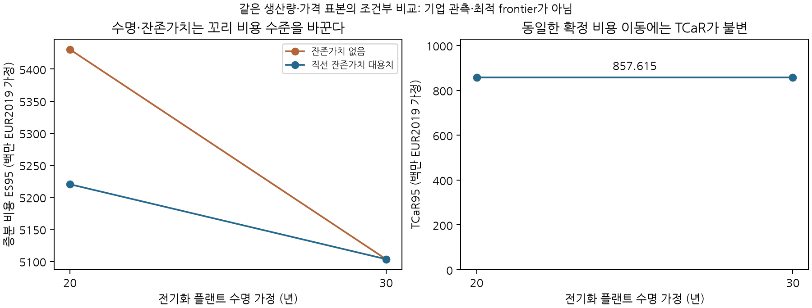

### 6.13 석유화학의 조건부 현금 원장과 확정 비용에 대한 TCaR 불변성

5.14절의 출판본 수치를 원료·전력·메탄 수지와 자본 지급 일정에 연결했다. 비교 대상은 동일한 에틸렌 생산량을 공급하는 신규 기존 방식 플랜트와 신규 전기화 플랜트다. 기존 기업 설비의 매몰비용·잔여 수명·개조비를 대신한 반사실이 아니다. 문헌에서 확정되지 않은 물리·재무 항목은 별도 가정으로 두며, 이 절의 추가 원장은 Excel의 기본 Layritz 부분 모형에 자동 채택되지 않는다.

**명시적 공정 가정.** 플랜트 용량은 원문115t/h, 연간 가동시간은 연구 가정8,000시간으로 양쪽 생산량을92만t/년에 고정했다. 원문의 과열·포화 증기 계통을 하나의 유효 열 서비스로 집계하는 근사에서, 기존 방식은 분해로 증기0.841에서 압축기 수요0.431을 뺀 잔량에 유효 이용률u를 곱한다. 전기화 방식은 포화 증기0.542에 같은u를 곱한다. 분리 증기 수요0.492의 부족분만 효율92% 보일러로 채운다. u=0.8·1.0은 민감도 가정이며 압력별 증기 수지나 실제 압축기 배기의 회수 가능성을 검증한 값이 아니다. 메탄 발생량에서 분해로·보일러 소비를 뺀 뒤 부족분은 구매, 잉여는 판매로 분리한다. 기본 실험의 잉여 판매비율은1이며, 기타 부산물 판매는 원장에 포함하지 않는다.

**명시적 비용 가정.** 2027–2029년 투자비 균등 지급,2030–2050년 가동, 실질 할인율5%를 적용했다. 기존 방식 플랜트 수명30년과 전기화 수명20·30년, 잔존가치 없음·직선 대용치, 원문 유지비 비율의 소수·문자 그대로의% 해석을 각각 분리했다. 유지비는 원문 식에 맞춰 연간 환산 투자비의 비율로 계산하고 초기·교체 투자비는 별도 현금 지급으로 처리한다. 보일러 수명25년과 원문 투자비 계수를 사용하되 이를 플랜트 곡선에 추가하는 범위는 연구 가정이다. 전력100EUR/MWh, 메탄 넷백40EUR/원문 에너지MWh, 나프타600EUR/t는 모두2019년 실질가격이라고 가정한 기준값이며 시장 관측으로 제시하지 않는다. 메탄의 질량·LHV·HHV 변환을 임의 추가하지 않았다. 노무비·탄소비·운전자본·조세·금융비용·기타 부산물 판매를 제외하므로 전체 기업 비용은 아니다.

IEA STEPS의 원유·일본 LNG 중심 경로는 기준연도 대비 비율만 사용한다. 나프타는 원유, 메탄은 LNG에 연결하며 전력은 기준가격의 절반을 고정하고 절반을 LNG에 연동한다. World Bank 공동 월별 충격을1·12개월 블록으로 생성해 연간 구매가격에 적용했다. 두 시드에서 각5,000경로를 사용했고, 공정·수명·회계 가정16개를 각각 평가했다. 64개 조건의 총64만 FIN 비용값이 독립 원장과 일치했으며 최대 차이는2.33×10⁻¹⁰백만EUR였다. 공통 나프타 비용은 두 절대 원장에 포함하되 같은 경로에서 빼면 상쇄됨을 별도 식으로 확인했다. 64개 조건이64개의 독립 실증은 아니며 네 난수 묶음을 공유한다.

<!-- NCC CONDITIONAL TABLE -->

**그림 1.** 유효 증기 이용률1, 소수 비율 유지비 해석,12개월 블록과 동일 평가 시드의 비교. 잔존가치는 관측 매각대금이 아닌 직선 대용치다. 연결선은 가정 간 비교를 돕는 표시이며 실행 가능한 연속 투자나 frontier를 뜻하지 않는다.

이 실험에서 수명·유지비·잔존가치는 가격에 노출되는 물량을 바꾸지 않고 경로마다 같은 확정 비용만 이동시킨다. 따라서 ES와 평균은 그 금액만큼 달라지지만 TCaR는 변하지 않는다. 두 가격 모형·두 시드·두 증기 이용률의8개 묶음에서 이 항등식이 유지됐다. 이는 TCaR의 수치 실패가 아니라4.2절에서 설명한 정의의 성질이다. 높은 확정 비용을 추가해도 TCaR가 같을 수 있으므로, 기술 대안의 유용성은 평균·원래 비용 분위수·ES 및 실행 가능성과 함께 판단해야 한다. 설비 수명을 유리하게 가정한 점을 기업이 실제 선택할 수 있는 ‘더 효율적인 투자’로 해석하지 않는다.
