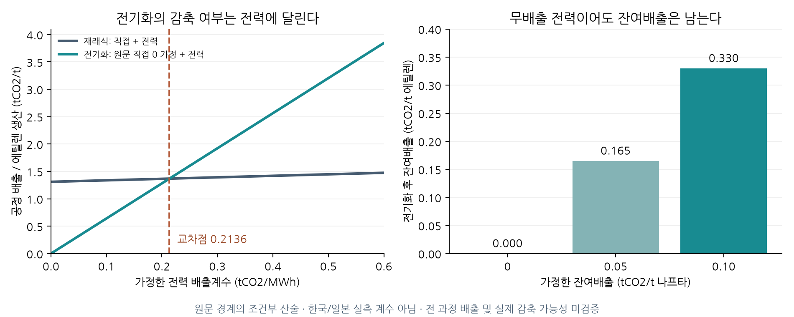

### 6.15 전기화는 언제 감축인가: 직접·전력·잔여 배출과 후보 자격

Tiggeloven et al.의 재래식 공정은 분해로와 보일러를 합한 직접배출을 0.397kgCO2/kg 나프타로 보고한다. 전기 공정의 직접배출은 0으로 가정하며, 두 안 모두 디코킹 배출과 Scope 3를 제외한다. 이 0은 실측된 완전 무배출을 뜻하지 않는다. 본 절은 출판본 PDF4–6쪽의 경계를 유지한 산술 진단이다. 가스의 열량 기준을 별도 확인하지 않은 상태에서 일반 천연가스 배출계수를 곱하지 않고, 원문이 보고한 직접배출 원단위를 그대로 사용한다. [Tiggeloven et al., 2023](https://doi.org/10.1021/acs.iecr.3c02226).

원문 Table1의 전력 수요는 나프타 톤당 재래식 0.083MWh, 전기화 1.942MWh이고 공통 에틸렌 수율은 0.303이다. 같은 전력 배출계수를 g(tCO2/MWh)라 하면 에틸렌 생산량당 공정 배출은 재래식 (0.397+0.083g)/0.303, 전기화 1.942g/0.303이다. 이는 공동생산 공정 배출을 에틸렌 생산량으로 정규화한 값이며 부산물에 배분한 제품 탄소발자국이 아니다. 교차점은 **g* = 0.397/1.859 ≈ 0.2136tCO2/MWh**다. 전기화는 g < g*에서 이 경계의 배출을 낮추고 g = g*에서 두 안의 배출이 같다. 표시값은 원문 계수의 정밀도를 넘는 물리적 정확도를 의미하지 않는다.

| 가정한 전력 배출계수 | 재래식 공정 | 전기화 공정 | 전기화 − 재래식 |
|---|---:|---:|---:|
<!-- EMISSIONS TABLE -->

첫 열은 tCO2/MWh, 나머지는 tCO2/t 에틸렌이다. 세 전력계수는 방향을 설명하기 위한 가정이며 한국·일본 관측값이나 미래 시나리오의 확률이 아니다.

**그림 1.** 왼쪽은 원문 경계의 직접배출과 전력 수요를 결합한 결과다. 오른쪽은 전력계수가 0이어도 별도 잔여배출이 남는다는 산술 예시다. 잔여배출 가정은 실제 디코킹 측정치나 상·하한이 아니다. 국가별 실제 감축 가능성을 판정한 그림도 아니다.

원문 밖의 잔여배출을 각 안의 나프타 톤당 r_c, r_e로 추가하면 증분배출은 [1.859g−0.397+(r_e−r_c)]/0.303이다. 두 안에서 같은 잔여배출은 증분 비교에서 상쇄되지만 각 안의 절대배출에는 남는다. 예를 들어 양쪽에 0.05tCO2/t 나프타를 똑같이 가정하면 교차점은 같고, 무배출 전력의 전기화에도 **0.1650tCO2/t 에틸렌**이 남는다. 외부로 판매·이전한 메탄의 사용단계 배출이나 나프타 제품 탄소가 사라진다고 해석하지 않는다. 전 과정 효과를 논하려면 해당 경계를 별도로 확장해야 한다.

6.14절의 기존 유지·2030년 전환 물량에 이 배출 경계를 연결했다. 증기 회수 가정은 1로 고정했으며, 회수 감소로 보일러 연료가 바뀌는 다른 사양에 원문 직접배출을 그대로 적용하지 않는다. 세 전력계수와 두 잔여배출 가정에서 두 계획의 연간 배출을 계산해 288행을 보존했다. 가상 목표를 각 조건의 2027년 재래식 배출에서 2050년 0까지 선형으로 두면, 전력계수와 잔여배출이 모두 0인 전환안은 말기 목표를 만족한다. 그러나 2030년 이전까지 기존 생산을 유지하므로 2028년부터 줄어드는 연간 목표는 위반한다. 이 예시는 실제 기업 선언의 재산출이 아니며, 같은 서비스의 비용 비교·말기 목표 달성·전체 연간 목표 달성이 서로 다른 검사임을 보여준다.

PPA의 가격 고정과 전력 배출 귀속도 분리해야 한다. GHG Protocol의 2015 Scope 2 Guidance는 지역 기반과 시장 기반 방법 및 계약 수단의 품질요건을 구별한다. 본 절의 공통 계통계수 g에 가격 계약비율을 곱해 배출을 자동 차감하지 않는다. 시장 기반 목표를 평가하려면 계약의 전력 속성·귀속과 미충당 전력의 계수를 별도 확인해야 하고, 그 회계 결과를 전력계통의 실제 배출 감소에 대한 인과 추정으로 확대하지 않는다. 인용 판본은 2015 지침이며, 공식 페이지에 안내된 후속 개정 절차를 완료된 새 규칙으로 적용하지 않았다. [GHG Protocol, Scope 2 Guidance](https://ghgprotocol.org/scope-2-guidance).

이번 진단은 기존 FIN의 탄소비용 미포함 상태나 기업별 기술 DB를 갱신한 것은 아니다. 비용 원장의 배출 0 자리표시자를 감축 실적으로 사용하지 않고 별도 배출 원장에서 후보 자격을 점검했다. 현재 결과는 해당 부분 경계의 조건부 검사다. 기업 공시의 배출 범위와 동일한 잔여배출·전력 경로가 확보되어야 전체 기업의 감축 제약과 효율경계를 연결할 수 있다.
