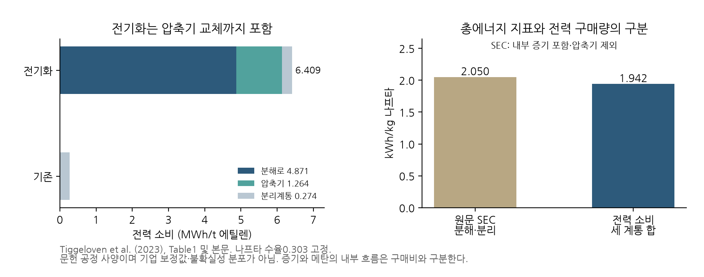

### 5.14 석유화학 참조 사양: 에너지 지표를 구매 원장으로 오독하지 않기

Tiggeloven et al. (2023)의 공개 출판본은 나프타 크래커를 분해·압축·분리 계통으로 나누고, 전기화·저장·재생전원과 운영 유연성을 함께 검토한다. 이 연구는 PPA 외 대응을 검토할 공정 근거이며, Layritz 사양을 보완하는 별도의 설계 참조다. 두 연구의 수치를 독립 반복 관측으로 합치거나 낮은 투입계수만 골라 하나의 기술로 만들지 않는다. 본 연구에서는 출판본 Table1·3·4와 식(3)의 이미지를 대조하고, 원자료와 단위 변환·채택 보류 이유를 별도 저장했다. [Tiggeloven et al., 2023, 공개 출판본](https://publications.tno.nl/publication/34641733/2nm91Z/tiggeloven-2023-optimization.pdf).

Table1의 에틸렌 수율0.303kg/kg 나프타를 고정하면 나프타 투입은3.300t/t 에틸렌이다. 전력 소비는 기존 공정0.274MWh/t, 전기화 공정6.409MWh/t이며 차이는6.135MWh/t다. 전기화 공정의 분해로·압축기·분리계통 전력을 모두 합산한 값이다. 기존 Layritz 부분 원장의 추가 전력6.780MWh/t와 평균하지 않는다. ‘전기화’라는 이름이 같아도 수율·압축기·열회수 경계가 다른 사양이며, 기업의 설비 구성과 맞는 묶음을 선택해야 한다.

**그림 1.** Tiggeloven 참조 공정의 전력 소비 분해와 에너지 지표의 경계. 오른쪽 원문 SEC2.050kWh/kg 나프타는 분해·분리 계통 지표이고, 세 계통의 전력 합계는1.942kWh/kg 나프타다. 내부 증기와 압축기의 포함 범위가 달라 두 값은 같은 구매량의 상충 관측이 아니다.

원문 SEC의 경계는 표에서 재구성할 수 있다. 기존 공정은 분해로 메탄1.868, 분리 증기0.492와 분리 전력0.083의 합2.443kWh/kg 나프타로, 본문의2.44에 대응한다. 전기화 공정은 분해로 전력1.476, 분리 증기0.492와 분리 전력0.083의 합2.051로 본문의2.05에 대응한다. 이 합산은 압축기를 제외하고 내부 회수 증기의 수요를 포함한다. 따라서 SEC에 전력가격을 곱해 구매비로 사용하는 것은 잘못이다. 전력 원장에는 전기화 공정의 압축기 전력0.383을 포함한1.942를 사용하고, 메탄·증기는 발생·내부 사용·외부 구매·판매를 별도 수지로 닫아야 한다. 과열증기와 포화증기의 값을 단순 차감해 외부 연료 구매량을 확정하지 않는다.

투자비는 Table3의2019년 유로 기준 총 overnight cost 곡선5126EUR/(kg 에틸렌/h)와 절편405백만EUR를 보존한다. 원문의 참조 규모115t/h에서 전체 플랜트 투자비는994.490백만EUR이며, 기존·전기화 공정에 같은 곡선을 적용한 것은 성숙 설계에 대한 저자의 가정이다. 이것이 기존 설비의 전기화 개조비가0이라는 뜻은 아니다. Table3 비용은 이미 설치·간접비·예비비 등을 반영한 값이므로 원문의 비용 계수를 다시 곱하지 않는다. 건설 지급 시점·교체 수명·지역 가격 조정 없이 이 곡선을 한국·일본 기업의 현금 투자비로 바로 채택하지 않는다.

유지비도 원문의 비용 정의를 따른다. 식(3)은 ‘(1+유지비 비율)×총 투자비×연간 환산계수’이며 유지비 부분은 연간 환산 투자비에 대한 비율이다. 총 투자비의 일정 비율을 매년 지급하는 별도 가정과 다르다. Table3의 비율 열 제목은%이고 셀에는0.04·0.02 등이 표시돼 있어, 재현 코드나 보충자료에서 해석을 확인하기 전에는 이를 임의로4%·2%로 확정하지 않는다. 검토한 본문에서 플랜트 연간 환산계수·수명을 확정하지 못했으므로 자동 FIN 채택을 보류한다. 원문은 원료 가격과 수율을 고정한 비교에서 나프타 구매비를 최적화 목적함수에서 제외하며, 디코킹·Scope3 및 일부 부대 비용도 제외한다. 출처가 있는 자본비 곡선을 확보했다는 사실만으로 전체 기업 비용 원장이 완성되지는 않는다.

이 참조의 운영 유연성 범위도 성공확률이나 기술계수 분포가 아니다. 향후 유연 운전·저장·자가발전 후보를 추가할 때에는 생산량·저장 손실·설비 규모·기동 제약을 먼저 정의하고, 동일한 원료·에너지 충격 아래 현금비용을 평가한다. 원문은 미래 전력가격과 전력 탄소집약도 프로파일을 서로 독립인 별도 분석에 사용했다고 밝힌다. 이를 공동 추출한 가격·배출 표본으로 재해석하지 않는다. 이 구분을 지켜야 선택 범위의 확대가 기업의 조건부 frontier를 어떻게 바꾸는지 검증할 수 있다.

**보충자료의 가격 생성법과 현금비용 경계.** 공개 보충자료의 식(1)은 2019년 네덜란드 시간별 전력가격을 ‘새 평균 + (원래 가격 − 원래 평균) × 새 표준편차 / 원래 표준편차’로 바꾼다. 16개 평균과10개 표준편차 조합의160개 경로는 민감도 격자이며 독립 미래 표본160개가 아니다. 양의 표준편차 배율에서는 시간별 순위와 표준화한 분포 형태가 그대로 유지되므로 새로운 극단 사건의 발생 순서나 꼬리 형태를 추정한 것도 아니다. 이 사실은 본문의 공동 블록 재표집과 구별한다. 보충자료2쪽의 평균 범위0–150EUR/kWh 표기는 같은 그림의 가격 축과 일관되지 않아 단위를 자동 수정·채택하지 않았다. 이 범위를 한국·일본 기업의 가격분포 가정으로 옮기지 않는다. [Tiggeloven et al., 보충자료 식(1)·그림S1](https://ndownloader.figshare.com/files/42479975).

보충자료 TableS6의 부산물7종 수율·가격14개 수치를 따로 보존했다. 이는 원문 비용배분용 입력이며 현장 순판매 넷백이나 통일된 실질가격연도의 가격 묶음이 아니다. 보충자료 식(2)는 최적화에서 제외했던 원료비를 다시 더한 총비용에 에틸렌 비용배분 비율CCAF를 곱한다. 이 지표와 기업의 ‘총 현금지출 − 실제 부산물 순판매 수입’은 서로 다르다. CCAF를 곱한 비용에서 판매액을 다시 빼면 이중 공제할 수 있다. 내부 소비 메탄을 외부 판매와 동시에 계상해서도 안 된다. 확보한9쪽 보충자료에서도 유지비 비율 해석과 플랜트 수명·환산계수는 확정하지 못했으므로 해당 채택 보류는 유지한다. 8,760시간의 기계 판독 가능한 결과 파일은 이 공개 첨부에서 확보하지 못했으며 실제 시간별 운영 결과를 재현했다고 표시하지 않는다.
