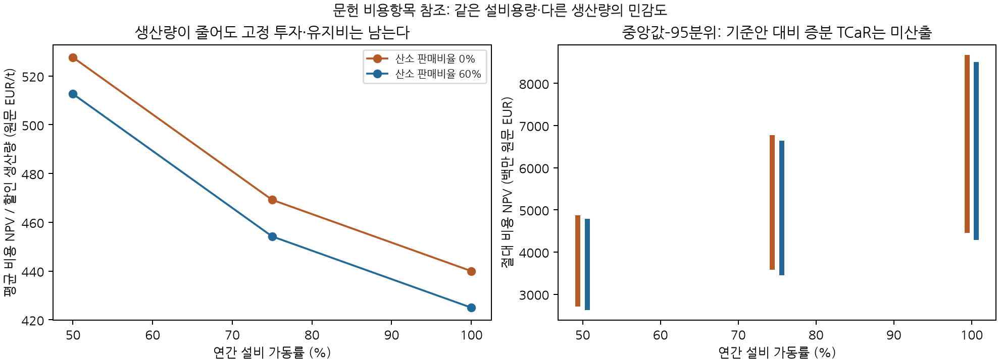

### 5.13 구성 설비 수명·가동률과 현금비용의 연결

기술 원단위는 설비용량과 실제 생산량을 구별하여 연간 현금흐름으로 옮긴다. 설비용량 K, 가동률 u(t), 가동 여부 a(t)에 대해 생산량은 Q(t)=K·u(t)·a(t)다. 구매 원료·전력과 이 원고의 노무비는 Q(t)에 비례시키고, 문헌이 초기 CAPEX의 일정 비율로 제시한 유지비는 K에 비례하는 가동 중 고정비로 놓는다. 정격 가동에서 제시된 유지비를 낮은 가동률에도 고정비로 확장하는 것은 연구 가정이다. 가동률0은 이미 투자한 설비의 존재나 유지비를 없애지 않는다. 폐쇄는 철거비·매각·상실 마진 등을 가진 별도 결정으로 구성해야 한다.

Vogl et al. (2018)의 비용항목을 사용한 참조 원장은 현장 수전해의 총전력3.48MWh/t, 펠릿·석회·합금·전극 구매, 산소 판매, 노무비와 유지비를 구성 설비별 투자비에 연결한다. 현장에서 생산하는 수소는 다시 구매비로 청구하지 않는다. 전해조160, 환원로230, 전기로184 EUR/(t 연산능력)에 각각10·20·20년 수명을 적용한다. 문헌의 연간 자본회수액53.9412 EUR/t은 원문 원가를 재현할 때만 사용하고, 현금 투자비와 함께 더하지 않는다. 원문의 복합 가격기준을 통일된2024년 실질가격이라고 부르지 않는다.

연산100만 톤·2027년 착수·3년 균등 지출·2030년 가동·2050년 종료·5% 할인이라는 예에서, 2040년 전해조 교체가 별도로 발생한다. 잔존 수입을 제외한 투자 NPV는 구성별 수명 적용818.830백만 원문 EUR, 공정 전체20년 축약733.978백만 EUR다. 종료연도 말의 잔여 수명으로 계산한 직선 잔존가치 대용치를 마지막 할인 구간에 반영하면 각각643.900과556.444가 된다. 대용치는 관측 매각대금이 아니며 기본 결과와 분리한다. 수명·평가기간·잔존가치 규칙은 기술별 비용을 다르게 움직이므로 frontier의 공통 회계 조건에 포함해야 한다.

고로 비교자료는 별도의 원문 검사를 거친다. Fischedick et al. (2014)의 기관 저자본은 EUR2010·LHV를 명시하지만 원료 준비와 환원제 상류 과정까지 포함한다. 부록의 ‘Ore’ 합계는 철광석과 스크랩을 합친 수치이므로 품목별 물량·가격으로 분리해야 한다. 또한 H-DR의 단계별 CO2 합409와 인쇄 합계339kg/t, BF-CCS 에너지 단계합1,751과 합계2,117MJ/t 등은 불일치로 보류했다. 96개 추출값과16개 합계·분류 검사 중5개 수치 불일치를 기록했으며, 숫자를 수정해 맞추거나 이 자료의 간접배출 포함 값을 기업 Scope1으로 대입하지 않았다. [Fischedick et al. 기관 저자본, §3.2·부록](https://d-nb.info/1104202093/34).

<!-- STEEL CASH CASES -->

### 6.11 철강 문헌 비용항목의 공동 가격·현금원장 실행

철강의 신규 실행은 문헌에 공개된 비용항목과 현금 투자·교체비를 합친 절대 참조비용이다. 같은 범위의 기존 고로 원장이 아직 완성되지 않아 기업의 전환 증분 TCaR나 신규 기업 frontier를 산출했다고 표시하지 않는다. 탄소 첨가·산소 정제·운전자본 등 미해결 항목도 그대로 드러낸다. 기존6.1–6.8절의 기업 결과를 이 실행으로 교체하지 않았다.

전력 중심값은40 원문 EUR/MWh에 고정비중50%와 IEA STEPS 일본 LNG의2024년 대비 무차원 가격비중50%를 결합한 예다. LNG의 USD2024 가격수준을 원문 EUR에 직접 더하지 않는다. 전력의 연동 부분과 펠릿 가격에는 동일한 World Bank 공동 블록 경로의 일본 LNG·철광석 배율을 각각 적용했다. 펠릿 중심값100 원문 EUR/t은 고정하고 품위·운송·조달 잔차를0으로 둔다. 산소 판매가는60.8 원문 EUR/t, 정제·판매비는0이라는 원가 재현 가정이며 실제 넷백의 검증값이 아니다. 자본비와 기타 원료비의 확률 충격, 탄소가격은 이 실험에서 제외했다.

가동률50·75·100%, 산소 판매비율0·60%, 블록 길이1·12개월, 독립 시드2개를 결합한24개 조건에서 각각1만 경로를 평가했다. 총24만 개 FIN 비용값을 별도 현금·물량 수식과 대조했다. 다음 표는12개월 블록·시드20260908·산소 판매비율60%다. 비용은 백만 원문 EUR이고, 마지막 열만 평균 NPV를 할인 생산량으로 나눈 EUR/t이다. 전체 미래 확률이나 회사 견적의 검증값이 아니다.

<!-- STEEL CASH TABLE -->

같은 설치용량에서 가동률이 낮아지면 총비용은 감소하지만 톤당 비용은 증가한다. 생산 서비스를 다르게 제공하는 이 점들을 그대로 비지배 선택에 넣으면 감산을 저위험 전환으로 잘못 평가할 수 있다. 동일 제품·물량·감축 의무를 유지하거나, 감산의 매출·마진·대체 공급·배출 이전을 명시해야 의미 있는 frontier가 된다. 산소 판매비율은 이 실험에서 확정적 수입만 바꾸므로 평균·분위수·ES를 같은 금액만큼 이동시키고 상위 분위수와 중앙값의 간격을 바꾸지 않는다. 이는 분포의 위치 이동과 불확실성 축소가 서로 다르다는 실제 계산 예다.

**그림 98.** 문헌 비용항목에 구성 설비별 현금 투자·교체를 연결한 가동률 민감도. 왼쪽은 평균 NPV/할인 생산량, 오른쪽은 절대비용의 중앙값–95분위 범위다. 생산량이 다르므로 이 그림은 효율경계가 아니다. 원문의 복합 가격기준과 미식별 조달·판매 가정은 본문에 명시했다.
